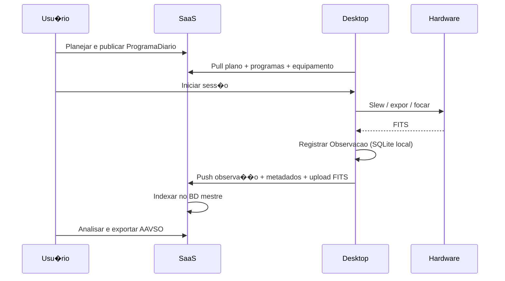

# Arquitetura SaaS + Desktop � AstroCitizen

**Vers�o:** 1.0  
**Data:** 2026-07-21  
**Status:** especifica��o de produto e arquitetura  
**Decis�o:** D-008  
**Relacionados:** [ARQUITETURA.md](ARQUITETURA.md) � [WORKFLOWS.md](WORKFLOWS.md) � [API_ALVO.md](API_ALVO.md) � [MODELO_DE_SINCRONIZACAO.md](MODELO_DE_SINCRONIZACAO.md)

---

## 1. Vis�o

O AstroCitizen opera como **dois m�dulos de produto** sobre um **dom�nio compartilhado**:

| M�dulo | Papel | Analogia |
|--------|-------|----------|
| **AstroCitizen SaaS** | Workspace, programas, planejamento, arquivo, an�lise, documenta��o, exporta��o | C�rebro organizacional e cient�fico |
| **AstroCitizen Desktop** | Opera��o do observat�rio, hardware, aquisi��o, sess�o, cache local | C�rebro operacional de campo |

**Princ�pio:** o SaaS **decide, organiza, armazena e analisa**; o Desktop **conecta, executa e captura**.

**Stack (D-009):** SaaS = FastAPI + Next.js + PostgreSQL/object storage BDaaS (padrão motorsport). Desktop = **PySide6** (UI + sync + hardware no mesmo processo; D-009.4-rev, D-010).

A separa��o n�o � �web vs desktop� em termos de neg�cio, mas **dois runtimes** com responsabilidades distintas e contratos expl�citos entre eles.

---

## 2. Diagrama geral

```text
???????????????????????????????????????????????????????????????????????
?                     AstroCitizen SaaS (cloud)                        ?
?  ???????????????  ???????????????  ???????????????  ?????????????? ?
?  ? Web UI      ?  ? REST/GraphQL?  ? Auth        ?  ? Workspace  ? ?
?  ???????????????  ???????????????  ???????????????  ?????????????? ?
?         ?                ?                                           ?
?  ????????????????????????????????????????????????????????????????  ?
?  ? Casos de uso: GerirSite � GerirProgramas � PlanejarDia       ?  ?
?  ?               Analisar � ExportarRede � ConsultarArquivo      ?  ?
?  ????????????????????????????????????????????????????????????????  ?
?         ?                                                           ?
?  ????????????????????????????????????????????????????????????????  ?
?  ? Dom�nio compartilhado (DDD) + plugins PO-*                    ?  ?
?  ????????????????????????????????????????????????????????????????  ?
?         ?                                                           ?
?  ???????????????????????  ??????????????????????????????????????  ?
?  ? PostgreSQL (mestre) ?  ? Object storage (FITS, plots, exp.) ?  ?
?  ???????????????????????  ??????????????????????????????????????  ?
???????????????????????????????????????????????????????????????????????
                                ?
                    Sync API + eventos
                                ?
???????????????????????????????????????????????????????????????????????
?                   AstroCitizen Desktop (edge)                        ?
?  ???????????????  ???????????????  ???????????????????????????????  ?
?  ? PySide6 UI  ?  ? CLI local   ?  ? Sync client + fila offline  ?  ?
?  ???????????????  ???????????????  ???????????????????????????????  ?
?         ?                ?                         ?                 ?
?  ??????????????????????????????????????????????????????????????????  ?
?  ? Casos de uso: ExecutarSessao � RegistrarObservacao            ?  ?
?  ?               ConectarEquipamento � DiagnosticarHardware     ?  ?
?  ??????????????????????????????????????????????????????????????????  ?
?         ?                                                           ?
?  ????????????????????????????????????????????????????????????????  ?
?  ? Mesmo dom�nio (biblioteca compartilhada)                    ?  ?
?  ????????????????????????????????????????????????????????????????  ?
?         ?                                                           ?
?  ???????????????????????  ??????????????????????????????????????  ?
?  ? SQLite (espelho)    ?  ? Storage local (FITS, cache, upload) ?  ?
?  ???????????????????????  ??????????????????????????????????????  ?
?         ?                                                           ?
?  ????????????????????????????????????????????????????????????????  ?
?  ? Ports de hardware: CameraPort � MountPort � FocuserPort �    ?  ?
?  ????????????????????????????????????????????????????????????????  ?
???????????????????????????????????????????????????????????????????????
          ?
          ?
???????????????????????????????????????????????????????????????????????
?              Observat�rio / instrumentos (local)                     ?
?  SBIG udrv � Alpaca/Alpyca � simuladores � ObservingConditions      ?
???????????????????????????????????????????????????????????????????????
```

---

## 3. Responsabilidades por m�dulo

### 3.1 AstroCitizen SaaS

| Bounded context | Responsabilidade |
|-----------------|------------------|
| `workspace` | Usu�rio, observat�rios, sites, perfis, permiss�es (futuro multi-user) |
| `programs` | Cat�logo PO-*, campanhas, alvos, cad�ncia, prioridades, produto m�nimo |
| `planning` | Efem�rides, meteo, ProgramaDiario, viabilidade (RN-010�056) |
| `archive` | Banco mestre, indexa��o, busca, auditoria, versionamento |
| `reduction` | Calibra��o, fotometria, espectro, astrometria, timing |
| `contribution` | Pacotes de export, valida��o atlas, hist�rico de submiss�es |
| `documentation` | Atlas, procedimentos, templates, logs interpret�veis |

**Casos de uso prim�rios:**

- `GerirSite`
- `GerirProgramas`
- `PlanejarDia`
- `ConsultarArquivo`
- `Analisar`
- `ExportarRede`
- `GerirWorkspace`
- `GerirDocumentacao`

**UI:** aplica��o web (dashboard, programas, planejamento, arquivo, an�lise, contribui��o).

### 3.2 AstroCitizen Desktop

| Bounded context | Responsabilidade |
|-----------------|------------------|
| `observatory-control` | C�mera, montagem, focuser, roda de filtros, condi��es locais |
| `session-runtime` | Execu��o de sess�o, fila de blocos, estados em tempo real |
| `acquisition` | Exposi��o, sequ�ncias, FITS, preview, headers |
| `local-cache` | Espelho operacional, fila de sync, artefatos pendentes |
| `desktop-tools` | Importa��o FITS, diagn�stico, autofoco, simulador |

**Casos de uso prim�rios:**

- `ExecutarSessao`
- `RegistrarObservacao` (aquisi��o local)
- `ConectarEquipamento`
- `DiagnosticarHardware`
- `CapturarFrames`
- `ImportarAquisicaoLocal`

**UI:** aplica��o nativa PySide6 (console de sess�o, preview, controle instrumental).

**Regra cr�tica:** a��es em tempo real (abortar exposi��o, focar, parar montagem) **nunca dependem** do SaaS estar online.

### 3.3 Casos de uso compartilhados

| Caso de uso | SaaS | Desktop | Nota |
|-------------|:----:|:-------:|------|
| `RegistrarObservacao` | ? (import/consulta) | ? (aquisi��o) | Desktop origina; SaaS consolida |
| `ConsultarObservacoes` | ? (fonte completa) | ? (cache local) | Desktop mostra espelho + pendentes |
| An�lise b�sica | ? (completa) | ? (preview opcional) | An�lise cient�fica no SaaS |
| Importa��o FITS | ? | ? | Desktop pode importar e sincronizar |

---

## 4. Fonte da verdade (source of truth)

| Dado | Fonte prim�ria | R�plica / cache |
|------|----------------|-----------------|
| Programas PO-*, campanhas | **SaaS** | Desktop (sync pull) |
| ProgramaDiario publicado | **SaaS** | Desktop (snapshot local na sess�o) |
| Sess�o em execu��o | **Desktop** | SaaS (eventos push) |
| Observa��o durante aquisi��o | **Desktop** | SaaS (ap�s sync) |
| FITS brutos | **Desktop** (origem) ? **SaaS** (c�pia/index) | URI no BD mestre |
| ProdutoAnalise | **SaaS** | � |
| ContribuicaoRede | **SaaS** | � |
| Invent�rio de equipamento | **SaaS** (cadastro) + **Desktop** (estado conex�o) | Desktop atualiza status local |
| Documenta��o / atlas | **SaaS** | Desktop (cache opcional) |

Ap�s sincroniza��o bem-sucedida, o **BD do SaaS** � a fonte de consulta cient�fica e hist�rica (RN-112).

---

## 5. Distribui��o dos modos de workflow

Mapeamento dos quatro modos de [WORKFLOWS.md](WORKFLOWS.md):

| Modo | SaaS | Desktop |
|------|:----:|:-------:|
| **1. Configurar** | Principal | Espelho (equipamento: estado local) |
| **2. Planejar** | Principal | Pull do plano publicado |
| **3. Executar** | Monitoramento remoto (futuro) | Principal |
| **4. Analisar e contribuir** | Principal | Opcional (preview) |

---

## 6. Estrutura de reposit�rio (alvo)

Monorepo recomendado na fase inicial:

```text
astrocitizen/
??? packages/
?   ??? domain/              # Entidades, regras RN-*, plugins PO-* (puro Python)
?   ??? ports/               # Interfaces (ArchivePort, CameraPort, SyncPort�)
?   ??? saas/
?   ?   ??? api/             # FastAPI ou equivalente
?   ?   ??? web/             # Frontend web
?   ?   ??? adapters/        # PostgreSQL, object storage, Astroquery�
?   ??? desktop/
?       ??? app/             # PySide6 Desktop (UI+sync+hardware)
?       ??? sync/            # Cliente de sincroniza��o
?       ??? adapters/        # SQLite local, Alpyca, udrv SBIG�
??? docs/
??? tests/
```

**Biblioteca compartilhada:** `domain` + `ports` � sem depend�ncia de UI nem de framework web.

Evolu��o poss�vel: extrair `domain` como pacote PyPI interno; SaaS e Desktop em deploys separados.

---

## 7. Persist�ncia

| Camada | SaaS | Desktop |
|--------|------|---------|
| BD relacional | PostgreSQL (mestre) | SQLite (espelho + fila sync) |
| Artefatos | Object storage (S3-compat�vel ou equivalente) | Filesystem local |
| �ndice de FITS | Tabela Observacao + URI | Mesma estrutura local; upload posterior |

Detalhe de sync: [MODELO_DE_SINCRONIZACAO.md](MODELO_DE_SINCRONIZACAO.md).  
Regras RN-110�116 aplicam-se a **ambos** os lados; o Desktop n�o pode �s� salvar em pasta� sem registro local (RN-110).

---

## 8. Comunica��o entre m�dulos

### 8.1 Sync API (Desktop ? SaaS)

- Autentica��o por token (OAuth2 / API key por dispositivo)
- REST JSON (v1); GraphQL opcional depois
- Upload de artefatos em chunks (FITS grandes)
- Batch de eventos e entidades

Ver contratos: [API_ALVO.md](API_ALVO.md).

### 8.2 Dire��o do fluxo



### 8.3 Eventos de dom�nio (audit trail)

Eventos m�nimos trocados ou replicados:

- `daily_plan.published`
- `session.started` / `session.ended`
- `block.started` / `block.completed` / `block.failed`
- `observation.recorded`
- `artifact.uploaded`
- `product.generated`
- `contribution.validated`

---

## 9. Seguran�a e credenciais

| Secret / credencial | Onde vive |
|---------------------|-----------|
| Login do usu�rio (SaaS) | SaaS (auth provider) |
| Token Desktop ? SaaS | Desktop (keyring OS) |
| Credenciais AAVSO/MPC/IOTA | SaaS (segredo por workspace, RN-082) |
| Endere�o Alpaca / udrv local | Desktop apenas |
| Chaves de API meteo | SaaS (planejamento); Desktop pode ter override local |

---

## 10. Disponibilidade e offline

| Cen�rio | Comportamento |
|---------|---------------|
| Internet OK | Sync cont�nuo; SaaS atualizado em near-real-time |
| Internet cai antes da sess�o | Desktop usa �ltimo plano sincronizado |
| Internet cai durante sess�o | Sess�o continua; fila local |
| Internet volta | Desktop reconcilia (MODELO_DE_SINCRONIZACAO) |
| SaaS indispon�vel | Desktop opera; alerta de sync pendente |
| Desktop sem login SaaS | Modo limitado: simulador + import local (sem push) |

---

## 11. Rela��o com arquitetura hexagonal existente

A decis�o D-003 (mon�lito modular + hexagonal + DDD) **permanece v�lida dentro de cada m�dulo** e na biblioteca `domain` compartilhada.

O que muda com D-008:

- Dois **deployables** (SaaS e Desktop)
- Nova porta: **`SyncPort`** / **`RemoteArchivePort`** no Desktop
- No SaaS: **`ArchivePort`** implementada sobre PostgreSQL + object storage
- Hardware ports (`CameraPort`, `MountPort`, �) **somente no Desktop**

```text
                    ????????????????
                    ?   domain     ?  ? compartilhado
                    ????????????????
           ?????????????????????????????????
           ?               ?               ?
    ??????????????  ??????????????  ??????????????
    ? SaaS       ?  ? Desktop    ?  ? Desktop    ?
    ? adapters   ?  ? sync       ?  ? hardware   ?
    ? PG, S3,    ?  ? client     ?  ? Alpyca,    ?
    ? web API    ?  ?            ?  ? udrv       ?
    ??????????????  ??????????????  ??????????????
```

---

## 12. Rela��o com sbig-suite

- **sbig-suite** permanece reposit�rio separado.
- Integra��o no **Desktop** via adapter `CameraPort` ? udrv.
- SaaS **n�o** fala com hardware diretamente.

---

## 13. Fases de implementa��o sugeridas

| Fase | Entrega |
|------|---------|
| **F1** | `domain` + `ports`; Desktop standalone (como hoje) com SQLite local |
| **F2** | SaaS API m�nima: auth, sites, programas, daily-plans |
| **F3** | Sync pull (plano ? Desktop) + push (observa��es ? SaaS) |
| **F4** | Upload de artefatos + arquivo unificado no SaaS |
| **F5** | An�lise e export no SaaS; Desktop focado em opera��o |
| **F6** | Web UI completa; monitoramento remoto de sess�o (opcional) |

O backlog existente (AC-*) pode ser reetiquetado por m�dulo nas pr�ximas revis�es do PRODUCT_BACKLOG.

---

## 14. Crit�rios de aceite arquitetural

1. Dom�nio e regras RN-* existem **uma vez** (pacote compartilhado).  
2. Desktop executa sess�o **sem** SaaS online (com plano j� sincronizado).  
3. Toda Observacao do Desktop chega ao BD mestre do SaaS ap�s sync.  
4. SaaS n�o importa Alpyca nem udrv.  
5. Planejamento e exporta��o funcionam **sem** Desktop instalado (modo SaaS-only para an�lise/import).  
6. Conflitos de sync t�m pol�tica documentada (MODELO_DE_SINCRONIZACAO).

---

## 15. Documentos derivados

| Documento | Conte�do |
|-----------|----------|
| [API_ALVO.md](API_ALVO.md) | Contratos REST entre Desktop e SaaS |
| [MODELO_DE_SINCRONIZACAO.md](MODELO_DE_SINCRONIZACAO.md) | Offline-first, fila, reconcilia��o |
| [decisoes/D-008-saas-desktop.md](decisoes/D-008-saas-desktop.md) | ADR da decis�o |

---

## 16. Hist�rico

| Vers�o | Data | Notas |
|--------|------|-------|
| 1.0 | 2026-07-21 | Arquitetura bifurcada SaaS + Desktop |
