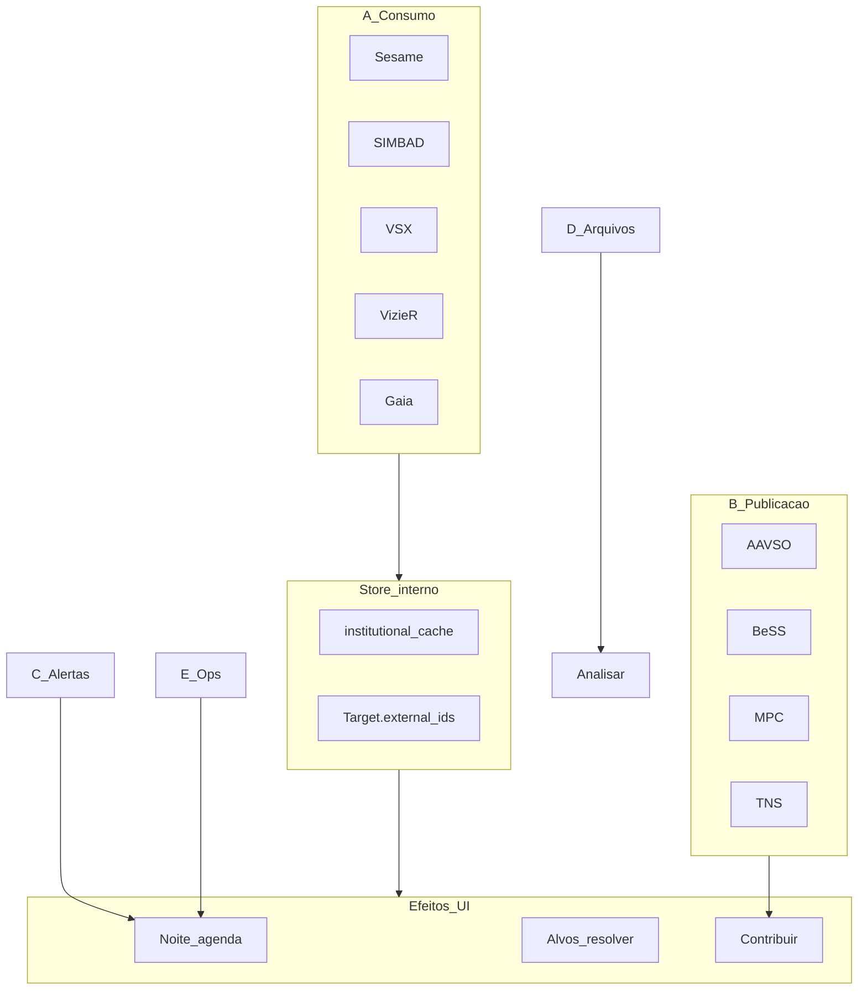

# Épico E22 — Hub científico, store interno e UX de efeitos

**Status:** planeamento aceite (documentação) · **Data:** 2026-07-24  
**Tipo:** épico guarda-chuva (planeamento + UX; não funde código de E20/E21/E4)  
**ADRs:** [D-012](decisoes/D-012-hub-integrations.md) · [D-013](decisoes/D-013-espelho-formularios-info.md)  
**UX:** [UX_E22_INTEROPERABILIDADE.md](UX_E22_INTEROPERABILIDADE.md)  
**Guia:** [GUIA_INTEROPERABILIDADE.md](GUIA_INTEROPERABILIDADE.md)

---

## 1. Objectivo

Organizar num único mapa de produto:

1. **Quais APIs** ligar (matriz A–E).
2. **Que informação** cada uma aporta.
3. **Que objectivo** serve no AstroCitizen.
4. **O que já está pronto** vs **o que falta**.
5. **Como a UI mostra efeitos** — sem aba de browse do store interno.

O store (`institutional_cache` + `Target.external_ids`) é **infra interna**. A UI de produto consome efeitos (agenda, alvos, Contribuir, alertas). A CLI (`catalog *`) e jobs de ingest alimentam o cache.

## 2. Relação com outros épicos

| Épico | Papel |
|-------|--------|
| **E20** | Providers / hub `integrations/` (código de ligação) |
| **E21** | Espelho SaaS + form schemas + cache / info services |
| **E4** | ASCOM Alpaca (hardware Desktop — **não** misturar com redes) |
| **E22** | Guarda-chuva: matriz APIs + inventário + UX de efeitos + ordem de sprints |

## 3. Matriz de APIs (A–E)

### A — Identidade / contexto do alvo (consumo → cache → agenda)

| API | Informação | Objectivo | Estado código | UI |
|-----|------------|---------|---------------|-----|
| **Sesame** | Nome → RA/Dec, otype | Resolver designação | ✅ AC-211 + cache | Nenhuma (efeito Alvos/Noite) |
| **SIMBAD** | Coords, aliases, tipo | Fallback identidade | ✅ + cache | Idem |
| **VSX** | AUID, tipo var., mag, período | Variáveis + AEF | ✅ + cache | Idem |
| **VizieR** | Catálogos tabelares | Contexto / calibração | ✅ AC-212 | Nenhuma |
| **Gaia TAP** | Astrometria fina, PM, G | Posição / prioridade | ✅ AC-213 | Nenhuma |
| **CDS X-Match** | Cruzamento multi-catálogo | Enriquecer IDs vizinhos | ❌ AC-233 | Nenhuma |

Facade actual: `CatalogResolveService` (Sesame → VSX → SIMBAD) · AC-226.

### B — Redes de contribuição (publicar / preparar ficheiro)

| API / canal | Informação / artefacto | Objectivo | Estado | UI |
|-------------|------------------------|---------|--------|-----|
| **AAVSO** (AEF→WebObs) | Fotometria Extended | PO variáveis | ✅ AC-096 | Contribuir |
| **AAVSO Spectroscopy** | Espectros rede AAVSO | Fase 2 | ❌ AC-217 | Contribuir / Analisar |
| **BeSS** | FITS 1D Be | Export espectro Be | ✅ skeleton | Contribuir |
| **ARAS** | Espectros (query/submit) | Fase 2 | ❌ AC-216 | Contribuir / Analisar |
| **MPC** | ADES / MPC80 | Asteroides/cometas | ✅ export | Contribuir |
| **TNS** | AT report | Transientes | ✅ sandbox/dry-run | Contribuir |

### C — Alertas → candidatos de plano

| API | Informação | Objectivo | Estado | UI |
|-----|------------|---------|--------|-----|
| **ALeRCE** | Alertas ZTF/Rubin | Candidatos | ❌ AC-218 | Inbox → Noite (Fase 3) |
| **Lasair** | Alertas ZTF | Idem | ❌ AC-218 | Idem |
| **SkyPortal/Fritz** | Projectos colaborativos | Só com PO concreto | Fora | — |

### D — Arquivos (consulta)

| API | Informação | Objectivo | Estado | UI |
|-----|------------|---------|--------|-----|
| **MAST** | Hubble/TESS/JWST… | Referência | ❌ AC-219 | Analisar / Arquivo (Fase 4) |
| **ESO Archive** | Dados ESO | Idem | ❌ AC-219 | Idem |
| **NOIRLab Data Lab** | Levantamentos | Opcional avançado | Fora | — |

### E — Operação da noite / aquisição

| API / sistema | Informação | Objectivo | Estado | UI |
|---------------|------------|---------|--------|-----|
| **JPL Horizons** | Efemérides SS | Alvos solares/cometas | Parcial AC-031 | Noite / Alvos |
| **Astrometry.net** | Plate solve | RA/Dec de FITS | Parcial AC-110 | Analisar |
| **Open-Meteo** | Nuvens, vento, RH… | Viabilidade | ✅ | Noite |
| **RainViewer** | Radar | Painel Noite | ✅ | Noite |
| **Meteoblue** | Meteo alt. | Alternativa | Fora / futuro | — |
| **CelesTrak** | TLEs | Evitar/tracking | Fora | — |
| **ASCOM Alpaca** | Câmara/mount/focuser… | Aquisição | E4 parcial | Observar / Sessão |
| **INDI** | Hardware Linux | Secundário | Opcional | — |
| **IVOA TAP/Cone** | Facade genérica | Multiplicador | ❌ AC-215 | Nenhuma |

## 4. Inventário — pronto vs lacuna

### Pronto

- Hub skeleton E20 (registry + providers AAVSO/MPC/TNS/BeSS/SIMBAD/VSX/Sesame)
- `institutional_cache` + CLI `catalog resolve|refresh-targets|cache-*`
- `CatalogResolveService` + plano diário com notas / mag tie-break (sem rede na geração)
- Shell UI U0–U5; Noite (meteo/radar/carta L0); Contribuir multi-rede parcial
- Form schema AAVSO (AC-220); D-012 / D-013 aceites

### Lacunas (código após esta documentação)

| Prioridade | Item | AC |
|------------|------|-----|
| P1 | CDS X-Match | AC-233 |
| P1 | Sync queue + SaaS scaffold | AC-222, AC-223 |
| P2 | ARAS / AAVSO Spec | AC-216, AC-217 |
| P2 | ALeRCE / Lasair → candidatos | AC-218 |
| P2 | Contribute UI por `features` + FieldReview schemas | AC-214, AC-221 |
| P2 | IVOA TAP facade | AC-215 |
| P3 | MAST / ESO | AC-219 |
| P2 | Ingest AID/LCG | AC-225 |
| P2 | Horizons deepen | evoluir AC-031 |

## 5. Itens deste épico (documentação / coordenação)

| ID | Item | Pri | Est | Dep | Notas |
|----|------|-----|-----|-----|-------|
| AC-230 | Doc épico E22 (este ficheiro) | P1 | S | D-012, D-013 | ✅ |
| AC-231 | UX E22 jornadas + fichas API | P1 | M | AC-230 | ✅ [UX_E22…](UX_E22_INTEROPERABILIDADE.md) |
| AC-232 | Matriz A–E no GUIA + links INDEX/backlog | P1 | S | AC-230 | ✅ |
| AC-233 | CDS X-Match provider + cache | P2 | M | AC-212 | Código futuro |
| AC-234 | UX: sync de dados do plano sem browse de cache | P1 | S | AC-231, AC-226 | Código futuro |

Implementação de providers continua sob **E20**; SaaS/forms sob **E21**; hardware sob **E4**.

## 6. Fases de entrega (produto)

| Fase | Foco | APIs | DoD parcial |
|------|------|------|-------------|
| **1** | Consumo → cache → agenda | Sesame, SIMBAD, VSX (+ VizieR/Gaia) | Plano offline com metadados; CLI catalog |
| **2** | Espectroscopia | ARAS, BeSS, AAVSO Spec | Contribuir espectro ponta a ponta |
| **3** | Transientes / alertas | TNS, ALeRCE, Lasair | Inbox → candidato no plano |
| **4** | Arquivos | MAST, ESO | Referência em Analisar |
| **5** | Automação | alertas→plano, one-click publish | Menos cliques; sync SaaS |

## 7. Anti-padrões (E22)

- Aba ou ecrã “Catálogo / cache” para o observador explorar APIs
- Proxy VSX/SIMBAD→UI sem gravar `institutional_cache`
- Misturar ASCOM Alpaca dentro de `integrations/`
- Gerar plano com rede obrigatória se o cache já estiver povoado
- Publicar sem `NetworkSubmission` / intenção de sync (D-013)

## 8. Definição de pronto (épico)

- [x] Matriz A–E documentada
- [x] Inventário pronto/lacuna
- [x] UX de efeitos (jornadas) documentada
- [x] Backlog E22 + links INDEX/GUIA/DESKTOP_UI
- [ ] Sprints de código (VizieR/Gaia, AC-234, …) — *fora desta entrega documental*

## 9. Referências

- Fonte externa: `moodle_espectroscopia/guia_astrocitizen.md`
- [PRODUCT_BACKLOG.md](PRODUCT_BACKLOG.md) E20 / E21 / E22
- [DESKTOP_UI_DESIGN.md](DESKTOP_UI_DESIGN.md)
