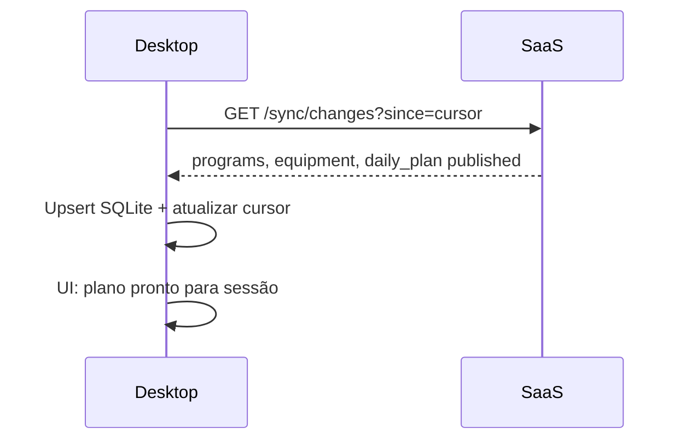
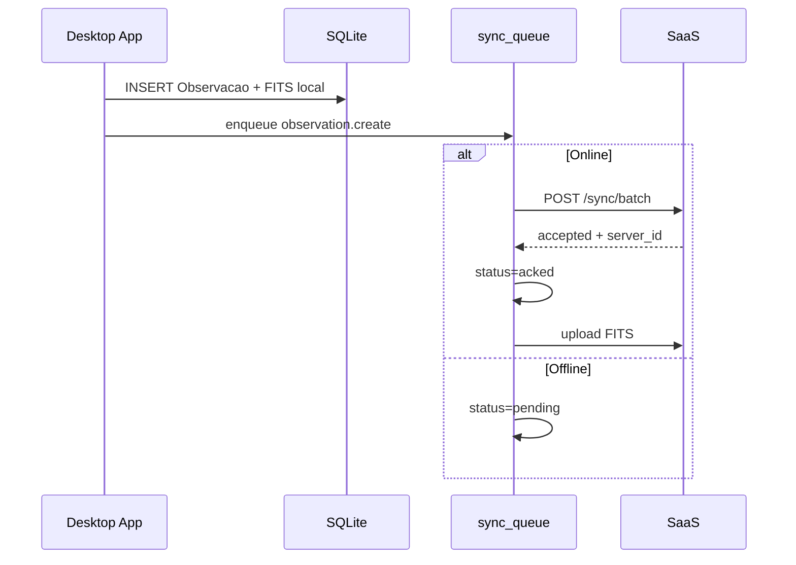

# Modelo de sincronização — AstroCitizen (Desktop ? SaaS)

**Versão:** 1.0  
**Data:** 2026-07-21  
**Status:** especificação  
**Relacionados:** [ARQUITETURA_SAAS_DESKTOP.md](ARQUITETURA_SAAS_DESKTOP.md) · [API_ALVO.md](API_ALVO.md) · RN-110…116

---

## 1. Objetivos

1. **Offline-first no Desktop** — sessão observacional não depende de internet.  
2. **Consolidação no SaaS** — após sync, BD mestre é fonte de consulta (RN-112).  
3. **Rastreabilidade** — nenhuma observação perdida; fila auditável.  
4. **Idempotência** — reenvio seguro após falha de rede.  
5. **Conflitos explícitos** — sem merge silencioso em dados científicos.

---

## 2. Modelo geral

```text
???????????????????????????????????????????????????????????
? Desktop                                                  ?
?  ????????????????    ???????????????    ??????????????? ?
?  ? App / Sessão ?????? SQLite      ?????? sync_queue  ? ?
?  ????????????????    ? (espelho)   ?    ??????????????? ?
?                      ???????????????           ?        ?
?  ????????????????                              ?        ?
?  ? FITS local   ????????????????????????????????        ?
?  ????????????????                              ?        ?
???????????????????????????????????????????????????????????
                                                 ?
                                    Sync Client (pull/push)
                                                 ?
???????????????????????????????????????????????????????????
? SaaS                                           ?        ?
?  ???????????????    ????????????????    ??????????????? ?
?  ? Sync API    ?????? PostgreSQL   ?    ? Object      ? ?
?  ???????????????    ? (mestre)     ?    ? storage     ? ?
?                     ????????????????    ??????????????? ?
???????????????????????????????????????????????????????????
```

---

## 3. Direções de sync

| Direção | Conteúdo | Gatilho |
|---------|----------|---------|
| **Pull** (SaaS ? Desktop) | Sites, equipamento, programas, planos publicados, templates PO-* | Login, periodicamente, antes da sessão |
| **Push** (Desktop ? SaaS) | Sessões, eventos, observações, metadados, uploads | Após cada obs. (se online) ou em batch |
| **Upload** (Desktop ? Storage) | FITS e artefatos grandes | Após metadados aceitos no SaaS |

O Desktop **não** faz push de `ProgramaDiario` editado no SaaS de volta como fonte — plano publicado no SaaS prevalece (ver §6).

---

## 4. Tabelas locais no Desktop

Além do espelho das entidades de domínio:

### 4.1 `sync_queue`

| Campo | Tipo | Descrição |
|-------|------|-----------|
| `id` | UUID | PK local |
| `client_op_id` | UUID | Idempotência |
| `entity_type` | text | `observation`, `session`, `session_event`, … |
| `operation` | text | `create`, `update` |
| `payload_json` | json | Corpo da operação |
| `status` | text | `pending`, `in_flight`, `acked`, `failed`, `conflict` |
| `retry_count` | int | Tentativas |
| `last_error` | text | Última falha |
| `created_at_utc` | datetime | |
| `acked_at_utc` | datetime | nullable |

### 4.2 `sync_cursor`

| Campo | Descrição |
|-------|-----------|
| `stream` | `pull_changes` |
| `cursor` | Token opaco do último pull bem-sucedido |
| `updated_at_utc` | |

### 4.3 `local_artifacts`

| Campo | Descrição |
|-------|-----------|
| `id` | UUID local |
| `observation_id` | FK local |
| `local_path` | Caminho FITS |
| `sha256` | Hash |
| `upload_status` | `pending`, `uploading`, `uploaded`, `failed` |
| `remote_artifact_id` | UUID no SaaS após upload |

### 4.4 `entity_versions`

Espelho de `id` + `version` por entidade puxada do SaaS — para detectar stale cache.

---

## 5. Fluxos

### 5.1 Pull antes da noite



Se não houver rede: usa último pull bem-sucedido; UI mostra badge **“plano pode estar desatualizado”**.

### 5.2 Push durante/após sessão



### 5.3 Retry com backoff

| Tentativa | Intervalo |
|-----------|-------------|
| 1–3 | 5 s |
| 4–6 | 30 s |
| 7+ | 5 min (até sucesso ou intervenção manual) |

Jobs `failed` permanentes (ex.: 422 business rule) ficam na fila com alerta ao usuário.

---

## 6. Política de conflitos

### 6.1 Regra geral

| Entidade | Autoridade em conflito | Política |
|----------|------------------------|----------|
| Site, Programa, Equipamento (cadastro) | **SaaS** | Desktop aceita versão servidor no pull |
| ProgramaDiario publicado | **SaaS** | Desktop não publica plano; só consome |
| Sessao em execução | **Desktop** | Push prevalece; SaaS registra |
| Observacao | **Desktop** (origem) | Push idempotente por `client_id` |
| ProdutoAnalise | **SaaS** | Desktop não escreve |
| ContribuicaoRede | **SaaS** | Desktop não escreve |

### 6.2 Version mismatch

Se Desktop envia `daily_plan_version` inferior à do servidor ao iniciar sessão:

- **Opção A (recomendada):** avisar usuário; oferecer re-pull do plano antes de continuar.  
- **Opção B:** permitir sessão com snapshot explícito `stale_plan=true` no registro (auditoria).

### 6.3 Duplicata por reenvio

`client_op_id` e `observation.client_id` garantem idempotência: segundo POST com mesmo id retorna `200` com mesmo `server_id`, sem duplicar linha.

### 6.4 Observação sem upload de FITS

Metadados podem ser `acked` antes do FITS. Estados:

1. `observation` acked, `artifact` pending upload  
2. Upload completa ? `artifact.uploaded`  
3. Job de integridade no SaaS detecta obs. sem artefato após timeout ? alerta

---

## 7. Estados de conectividade (UI Desktop)

| Estado | Comportamento |
|--------|---------------|
| `online_synced` | Pull recente; fila vazia |
| `online_pending` | Fila com itens; sync em progresso |
| `offline_ready` | Plano em cache; sessão permitida |
| `offline_stale` | Cache antigo (> N horas configurável) |
| `unauthenticated` | Só simulador / import local |

---

## 8. Snapshot de sessão (RN-056)

Ao iniciar sessão no Desktop:

1. Copiar `ProgramaDiario` + blocos para tabela `session_plan_snapshot` (imutável).  
2. Enviar `daily_plan_id` + `daily_plan_version` ao SaaS.  
3. SaaS valida versão e registra `Sessao` com referência ao snapshot do servidor.

O snapshot local **não muda** se o plano for republicado no SaaS durante a sessão.

---

## 9. Meteo e efemérides (RN-113)

| Dado | Onde nasce | Persistência |
|------|------------|--------------|
| Meteo usada no plano | SaaS (planejamento) | BD SaaS |
| Meteo início/fim sessão | Desktop | Push ? BD SaaS |
| Efemérides do plano | SaaS | BD SaaS + cache Desktop no pull |
| Efeméride no momento da obs. | Desktop (opcional) | Metadados da Observacao |

---

## 10. Segurança do sync

- TLS obrigatório  
- Token de dispositivo com escopo limitado ao workspace  
- Upload presigned com expiração curta  
- Hash SHA-256 verificado no servidor após upload  
- Revogação de device no SaaS bloqueia push (pull de programas também)

---

## 11. Integridade e jobs

### SaaS (periódicos)

- Observações sem artefato após 24 h  
- Artefatos órfãos no object storage  
- `sync_queue` Desktop: N/A (local)

### Desktop (local)

- FITS sem linha em `Observacao`  
- Itens `pending` na fila > 7 dias ? alerta

---

## 12. Modo SaaS-only (sem Desktop)

Usuário pode:

- planejar no SaaS  
- importar FITS via web  
- analisar e exportar  

Sem participação do sync client. Observações importadas via API web seguem mesmo modelo de `Observation` no BD mestre.

---

## 13. Critérios de aceite (sync)

1. Sessão completa offline com ?1 observação; sync posterior sem perda.  
2. Reenvio duplicado não cria observação duplicada no SaaS.  
3. Plano republicado no SaaS não altera snapshot de sessão ativa no Desktop.  
4. FITS de 50 MB+ suporta upload retomável (chunks).  
5. Falha 503 durante push mantém fila `pending` e retry automático.

---

## 14. Histórico

| Versão | Data | Notas |
|--------|------|-------|
| 1.0 | 2026-07-21 | Modelo offline-first inicial |
