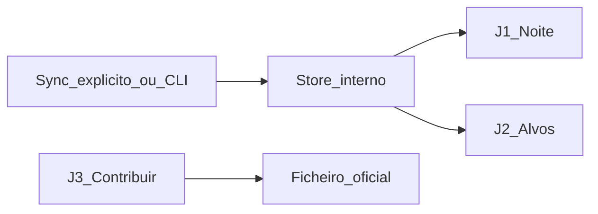

# UX E22 — Interoperabilidade: efeitos na UI (sem browse do store)

**Status:** especificação · **Data:** 2026-07-24  
**Épico:** [EPICO_E22_HUB_CIENTIFICO.md](EPICO_E22_HUB_CIENTIFICO.md)  
**Shell actual:** [DESKTOP_UI_DESIGN.md](DESKTOP_UI_DESIGN.md) (7 áreas U0–U5 + Catálogo)  
**Princípio:** o observador vê **efeitos** (agenda, alvos, Contribuir, alertas) e a **ficha unificada** do objecto.  
O `institutional_cache` **não** tem aba de exploração raw — o menu **Catálogo** mostra a ficha consolidada (`catalog_objects`).

---

## 1. Anti-padrões UX

| Evitar | Preferir |
|--------|----------|
| Lista de providers / JSON de cache institucional | Ficha por secções (posição, fotometria, …) no menu Catálogo |
| Lista “Sesame / VSX / SIMBAD” como UI principal | Uma busca: “Buscar / actualizar” (multi-API → nosso buffer) |
| Rede obrigatória ao “Gerar plano” | Plano offline; sync explícito e raro |
| Ecrã por cada API de consumo | Ficha API = “UI: nenhuma” + jornada afectada; ficha celeste unificada = Catálogo |

---

## 2. Mapa jornada → áreas da shell

| Jornada | Área nav | Tab / ecrã |
|---------|----------|------------|
| J1 Agenda enriquecida | Noite | Meteo / carta + blocos do plano |
| J2 Resolver alvo | Configurar | Alvos |
| J2b Ficha completa | **Catalogo** | Busca + formulário por domínio físico |
| J3 Contribuir por rede | Contribuir | Rede seleccionada |
| J4 Alertas → candidatos | Observatório / Noite | Inbox (futuro) → plano |
| J5 Arquivos referência | Analisar / Arquivo | Contexto anexo (futuro) |
| J6 Ops (meteo / ASCOM / Horizons) | Noite / Observar / Sessão | Existente + evolução E4 |



---

## 3. Jornadas (wireframes)

### J1 — Noite: agenda enriquecida

**Objectivo:** Ver o plano da noite com metadados úteis (tipo, mag, período) vindos do *nosso* store, sem abrir APIs.

**Dados visíveis:** designation, status, prioridade, alt, notas derivadas (`vsx_type`, `mag_max`, `period`).  
**Acções:** Gerar plano; (futuro AC-234) “Actualizar dados dos alvos” = refresh cache + regenerar notas.  
**Estados:**

- Vazio: sem programas active / sem alvos → empty state existente.
- Sem metadados: coluna Catálogo “—”; plano continua só com coords.
- Offline: gerar plano OK se cache/coords locais existirem.

**Não mostrar:** nome do provider, JSON raw, lista do `institutional_cache`.

```text
┌─ Noite · Meteo / carta ─────────────────────────────────────┐
│ Site [____]  Noite [yyyy-mm-dd]  Meteo [Open-Meteo]  [badge]│
│ [Atualizar noite]  [Actualizar dados dos alvos]  [Gerar plano]│
│                                                              │
│ Viabilidade / forecast …                                     │
│ ┌─ Blocos do plano ───────────────────────────────────────┐ │
│ │ # │ Alvo    │ Status   │ Pri │ Alt° │ Tipo/mag/período │ │
│ │ 0 │ SS Cyg  │ agendado │  1  │ 42.1 │ UGSS · 7.7 · 0.27│ │
│ │ 1 │ …       │ …        │ …   │ …    │ —                │ │
│ └─────────────────────────────────────────────────────────┘ │
│ Carta do plano (L0) …                                        │
└──────────────────────────────────────────────────────────────┘
```

**Nota de migração:** hoje existem botões residuais “Atualizar catálogo” / texto “Catálogo”. AC-234 renomeia para linguagem de *dados do plano* e remove qualquer conotação de browse.

---

### J2 — Alvos: resolver nome

**Objectivo:** A partir da designação, preencher RA/Dec e IDs externos no Target (efeito do resolve).

**Dados visíveis:** designation, RA, Dec, tipo, resumo curto (AUID / tipo var. / mag) na linha ou detalhe.  
**Acções:** Novo / Editar / Remover; “Resolver por nome” (rede + grava cache + Target).  
**Estados:**

- Miss: diálogo “não encontrado”; Target inalterado.
- Sucesso: coords + resumo; sem listar quais APIs responderam (opcional: “actualizado agora” no detalhe).

**Não mostrar:** escolha multi-provider; dump de cache.

```text
┌─ Configurar · Alvos ────────────────────────────────────────┐
│ Alvos (N)                                                    │
│ [Novo] [Editar] [Remover] [Resolver por nome] [Atualizar]    │
│                                                              │
│ Designacao │ RA     │ Dec    │ Tipo │ Resumo               │
│ SS Cyg     │ 325.68 │ 43.59  │ star │ AUID… · UGSS · 7.7   │
│                                                              │
│ seleccionado=SS Cyg · mag_max=7.7 · auid=000-…               │
└──────────────────────────────────────────────────────────────┘
```

---

### J3 — Contribuir por rede

**Objectivo:** Preparar artefacto oficial (AEF, ADES, BeSS, TNS…) a partir do domínio + form schema; abrir WebObs / dry-run conforme rede.

**Dados visíveis:** campos atlas (FieldReview), produto ligado, estado da submission.  
**Acções:** Revisar campos → Gerar ficheiro → (AAVSO) abrir WebObs.  
**Estados:** validação falhada; dry-run; sucesso com path.

**Não mostrar:** store institucional; APIs de catálogo (exceto pré-fill AUID já no Target).

```text
┌─ Contribuir · AAVSO ────────────────────────────────────────┐
│ Rede: AAVSO          Schema: aavso@…                         │
│ [Revisar campos]  star=SS CYG  obscode=…  band=V  …          │
│ Produto: [fotometria…]                                       │
│ [Gerar AEF]  [Abrir WebObs]                                  │
│ submission=… status=prepared  artifact=file://…              │
└──────────────────────────────────────────────────────────────┘
```

Redes futuras (ARAS, AAVSO Spec): mesmo padrão de ecrã; schema próprio.

---

### J4 — Alertas → candidatos (Fase 3)

**Objectivo:** Inbox de alertas (ALeRCE/Lasair) → criar/ligar Target + bloco candidato no plano.

**Dados visíveis:** nome/coords alerta, mag, idade, filtro.  
**Acções:** Ignorar · Adicionar ao programa · Sugerir para esta noite.  
**Estados:** vazio; erro de rede; offline = última inbox em cache local (futuro).

**Não mostrar:** raw VOEvent completo por defeito (detalhe expansível OK).

```text
┌─ Observatório · Alertas (futuro) ───────────────────────────┐
│ Filtro [ZTF · últimas 24h]                    [Atualizar]   │
│ Alerta          │ Mag │ Idade │ Acções                       │
│ AT2026…        │ 17.2│ 2h    │ [Ignorar] [→ Programa] [Noite]│
└──────────────────────────────────────────────────────────────┘
```

---

### J5 — Arquivos de referência (Fase 4)

**Objectivo:** Em Analisar / Arquivo, anexar contexto MAST/ESO a um produto (não hub “arquivo espacial”).

**Dados visíveis:** mission, obs id, link, thumbnail se houver.  
**Acções:** Pesquisar por coords/nome do Target actual → Anexar referência.  
**Não mostrar:** browser genérico de todo o MAST.

```text
┌─ Analisar · Espectro (futuro: Referências) ─────────────────┐
│ Produto actual: …                                            │
│ Referências: [Pesquisar MAST/ESO]                            │
│  · HST …  [Abrir] [Anexar]                                   │
└──────────────────────────────────────────────────────────────┘
```

---

### J6 — Ops (meteo, ASCOM, Horizons)

| Função | Onde | Estado UX | Nota |
|--------|------|-----------|------|
| Meteo + radar | Noite | ✅ | Open-Meteo + RainViewer |
| Carta plano L0 | Noite | ✅ | Não é planetário |
| ASCOM / sim | Observar / Sessão | Parcial E4 | Fora de `integrations/` |
| Horizons | Alvos / Noite | A aprofundar | Só quando alvo SS / cometa |
| Plate-solve | Analisar | Parcial | Astrometry.net |

Sem ecrã “lista de APIs ops”.

---

## 4. Fichas por API (UI)

Legenda UI: **nenhuma** = só store/CLI; **jornada** = ecrã de efeito.

### Grupo A — Consumo

| API | Informação | Objectivo | UI | Jornada | Código |
|-----|------------|---------|-----|---------|--------|
| Sesame | RA/Dec, otype | Resolver nome | nenhuma | J1, J2 | ✅ |
| SIMBAD | Identidade, coords | Fallback | nenhuma | J1, J2 | ✅ |
| VSX | AUID, tipo, mag, período | Variáveis | nenhuma | J1, J2, J3 | ✅ |
| VizieR | Tabelas catálogo | Contexto | nenhuma | J1, J2 | ✅ AC-212 |
| Gaia | Astrometria fina | Posição/PM | nenhuma | J1, J2 | ✅ AC-213 |
| X-Match | Cruzamento | IDs | nenhuma | J2 | ❌ AC-233 |

### Grupo B — Publicação

| API | Informação | Objectivo | UI | Jornada | Código |
|-----|------------|---------|-----|---------|--------|
| AAVSO fotometria | AEF / WebObs | Submit vars | Contribuir | J3 | ✅ |
| AAVSO Spec | Espectro | Fase 2 | Contribuir | J3 | ❌ |
| BeSS | FITS 1D | Be stars | Contribuir | J3 | ✅ skel. |
| ARAS | Espectro | Fase 2 | Contribuir | J3 | ❌ |
| MPC | ADES | Astrometria | Contribuir | J3 | ✅ |
| TNS | AT report | Transientes | Contribuir | J3 | ✅ |

### Grupo C — Alertas

| API | Informação | Objectivo | UI | Jornada | Código |
|-----|------------|---------|-----|---------|--------|
| ALeRCE | Alertas | Candidatos | Inbox | J4 | ❌ |
| Lasair | Alertas | Candidatos | Inbox | J4 | ❌ |

### Grupo D — Arquivos

| API | Informação | Objectivo | UI | Jornada | Código |
|-----|------------|---------|-----|---------|--------|
| MAST | Arquivo espacial | Referência | Analisar | J5 | ❌ |
| ESO | Arquivo ESO | Referência | Analisar | J5 | ❌ |

### Grupo E — Ops

| API | Informação | Objectivo | UI | Jornada | Código |
|-----|------------|---------|-----|---------|--------|
| Horizons | Efemérides | SS | Alvos/Noite | J6 | parcial |
| Astrometry.net | WCS | Plate solve | Analisar | J6 | parcial |
| Open-Meteo | Meteo | Viabilidade | Noite | J6 | ✅ |
| RainViewer | Radar + mapa Leaflet | Noite | Noite | J6 | ✅ embutido/modal |
| ASCOM Alpaca | Hardware | Aquisição | Observar | J6 | E4 |
| IVOA TAP | Facade | Multiplicador | nenhuma | — | ❌ |

---

## 5. Linguagem de UI (copy)

| Evitar | Usar |
|--------|------|
| Catálogo / Cache / Sesame / Provider (no chrome do plano) | Dados do plano · Resolver por nome · Actualizar dados dos alvos |
| institutional_cache | (nunca na UI) |
| Mag “misteriosa” sem banda | Campos V/B/R + `band_notes` na ficha Catálogo |
| API miss | Não encontrado · Tente outro nome |

Menu **Catálogo** é intencional (ficha unificada). CLI `catalog *` continua para ops.

---

## 6. Critérios de aceite UX (E22 docs)

1. Nenhuma jornada exige “abrir o store” raw.
2. Cada API da matriz tem ficha com UI explícita (nenhuma ou jornada).
3. J1–J3 + J2b (Catálogo) alinhadas ao shell; J4–J5 futuro.
4. Fotometria na ficha segue política por tipo (AC-236) — ver [SPRINT_AC235_CATALOGO.md](SPRINT_AC235_CATALOGO.md).

## 7. Histórico

| Ver. | Data | Nota |
|------|------|------|
| 1.0 | 2026-07-24 | Especificação inicial E22 |
| 1.1 | 2026-07-24 | J2b Catálogo + AC-235/236 fotometria |
