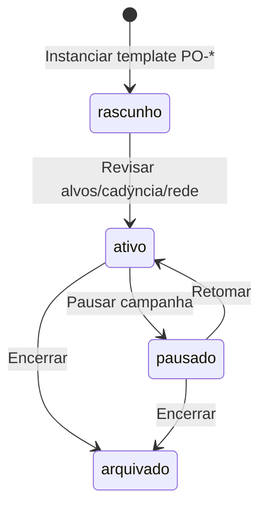
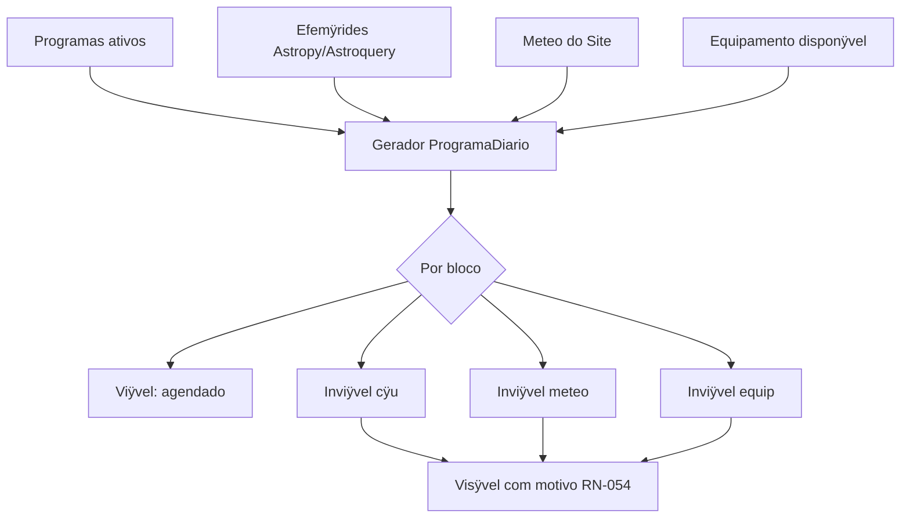
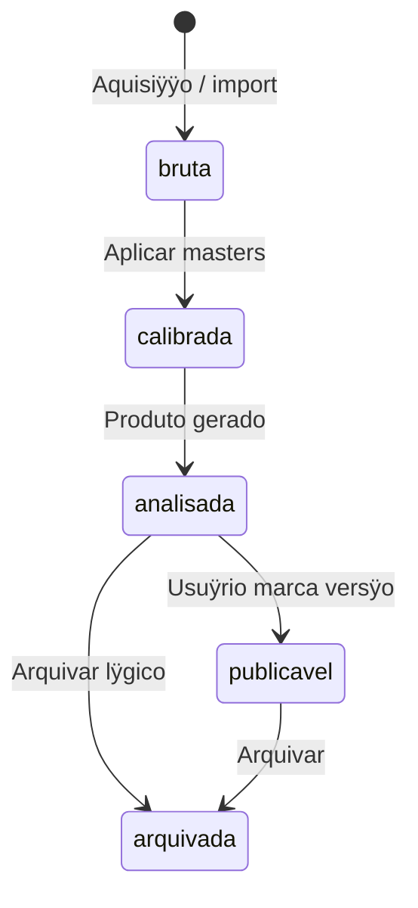
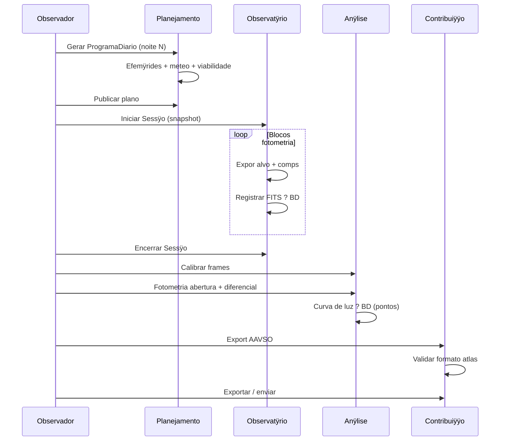

# Workflows e jornada do usuÿrio ÿ AstroCitizen

**Versÿo:** 1.0  
**Data:** 2026-07-21  
**Status:** especificaÿÿo de produto  
**Fontes:** [ESCOPO_GERAL_E_REGRAS_DE_NEGOCIO.md](ESCOPO_GERAL_E_REGRAS_DE_NEGOCIO.md) (RN-*), [ARQUITETURA.md](ARQUITETURA.md), [PRODUCT_BACKLOG.md](PRODUCT_BACKLOG.md) (AC-*), [PROGRAMAS_OBSERVACIONAIS.md](PROGRAMAS_OBSERVACIONAIS.md) (PO-*)

---

## 1. Propÿsito deste documento

Formaliza a **jornada do usuÿrio** na plataforma: modos de uso, passos, estados, alternativas e mapeamento para casos de uso e backlog.

O fluxo de **domÿnio** (entidades, RN-*) jÿ estÿ em `ESCOPO_GERAL_E_REGRAS_DE_NEGOCIO.md` ÿ5. Este documento traduz isso em **experiÿncia de produto** (CLI/GUI, decisÿes do observador, telas-alvo).

Contratos de serviÿo detalhados: ver `API_ALVO.md` (pendente).

---

## 2. Personas e perfis de uso

Na v1, **Observador** e **Gestor de programa** sÿo o mesmo usuÿrio (RN implÿcito em ÿ3 do escopo).

| Persona | Objetivo tÿpico | Modos mais usados |
|---------|-----------------|-------------------|
| **Observador iniciante** | Configurar site, ativar primeiro PO-*, planejar a noite | Configurar ? Planejar |
| **Observador de campo** | Executar sessÿo com hardware, registrar FITS | Executar ? Registrar |
| **Analista offline** | Importar dados, calibrar, produzir curva/espectro, exportar | Analisar ? Contribuir |
| **Gestor de campanhas** | Vÿrios PO-* ativos, prioridades, contribuiÿÿes pendentes | Configurar ? Planejar ? Contribuir |

Cada persona pode usar **apenas um subconjunto** da jornada (RN-055: planejamento sem hardware; anÿlise dias depois ÿ RN-073).

---

## 3. Jornada macro (quatro modos)

| Modo | Caso de uso (app) | ÿpicos backlog | Regras-chave |
|------|-------------------|----------------|--------------|
| **Configurar** | `GerirSite`, `GerirEquipamento`, `GerirProgramas` | E2, E7 | RN-001ÿ004, RN-030ÿ035, RN-040ÿ047 |
| **Planejar** | `PlanejarDia` | E3, E7 | RN-010ÿ014, RN-020ÿ024, RN-050ÿ056 |
| **Executar** | `ExecutarSessao`, `RegistrarObservacao` | E4, E5, E7 | RN-060ÿ064, RN-090ÿ092 |
| **Analisar e contribuir** | `Analisar`, `ExportarRede` | E6, E9ÿE14, E7 | RN-070ÿ073, RN-080ÿ083, RN-110ÿ116 |

---

## 4. Mapa de navegaÿÿo (GUI-alvo)

Shell PySide6 com mÿdulos alinhados aos bounded contexts (AC-071):

| ÿrea | Conteÿdo principal | Workflow ÿ |
|------|-------------------|------------|
| **Inÿcio** | Site ativo, meteo resumida, programa diÿrio de hoje, alertas | ÿ5, ÿ6 |
| **Sites** | CRUD SiteProfile, limiares meteo/altitude | ÿ5.1 |
| **Equipamento** | Inventÿrio, configuraÿÿes instrumentais, backends | ÿ5.2 |
| **Programas** | Catÿlogo PO-*, campanhas ativas, painel multi-programa | ÿ5.3 |
| **Planejamento** | Programa diÿrio, timeline, blocos, viabilidade | ÿ6 |
| **Observatÿrio** | Sessÿo ao vivo, cÿmera/montagem/focuser, fila de blocos | ÿ7 |
| **Arquivo** | Observaÿÿes, produtos, busca por programa/alvo/data | ÿ8 |
| **Anÿlise** | Reduÿÿo, curvas, espectros, astrometria (por tÿcnica) | ÿ8 |
| **Contribuiÿÿo** | Rascunhos de export, validaÿÿo, envio | ÿ9 |
| **Diagnÿstico** | Simuladores, teste de hardware (RN-090 exceÿÿo) | ÿ7.4 |

CLI espelha os mesmos fluxos (AC-070): `astrocitizen site ÿ`, `program ÿ`, `plan ÿ`, `session ÿ`, `analyze ÿ`, `export ÿ`.

---

## 5. Modo 1 ÿ Configurar

### 5.1 Cadastrar e selecionar Site

**Objetivo:** todo planejamento e registro referem-se a um local explÿcito (RN-001).

| Passo | Aÿÿo do usuÿrio | Sistema | Saÿda |
|-------|-----------------|---------|-------|
| 1 | Criar Site (nome, lat, lon, alt, fuso) | Valida coordenadas | Site no BD |
| 2 | Opcional: limiares (alt. mÿn., meteo, crepÿsculo) | Defaults da plataforma + override | SiteProfile completo |
| 3 | Definir Site **ativo** | Recalcula caches de efemÿrides/meteo se houver plano | Contexto global da sessÿo UI/CLI |

**Alternativas:** editar Site existente; trocar Site ativo ? ProgramaDiario em ediÿÿo deve ser recalculado (RN-002).

**Backlog:** AC-020, AC-072.

---

### 5.2 Inventÿrio de equipamento

**Objetivo:** blocos do programa diÿrio declaram configuraÿÿo instrumental vÿlida (RN-030ÿ035).

| Passo | Aÿÿo | Sistema | Saÿda |
|-------|------|---------|-------|
| 1 | Registrar item (montagem, cÿmera, focuser, filtro, espectrÿgrafoÿ) | Tipo + metadados + backend | Equipamento no BD |
| 2 | Marcar disponibilidade (manutenÿÿo) | RN-035 | Flag no inventÿrio |
| 3 | Criar **ConfiguraÿÿoInstrumental** (preset) | Valida compatibilidade tÿcnica | Preset reutilizÿvel |
| 4 | Escolher backend de cÿmera: `sim` \| `alpaca` \| `udrv` | AC-046 | Preferÿncia persistida |

**Alternativas:** diagnÿstico de conexÿo Alpaca/udrv (sem Sessao ativa ÿ RN-090).

**Backlog:** AC-021, AC-040ÿ047, AC-072.

---

### 5.3 Ativar programas observacionais (PO-*)

**Objetivo:** campanhas de longo prazo alimentam candidatos do programa diÿrio (RN-040ÿ047).

| Passo | Aÿÿo | Sistema | Saÿda |
|-------|------|---------|-------|
| 1 | Escolher template **PO-*** no catÿlogo | Carrega metadados (tÿcnica, rede, produto mÿnimo) | ProgramaObservacional `rascunho` |
| 2 | Configurar alvos, cadÿncia, prioridade, config. instrumental padrÿo | Valida contra CS-* / PO-* | Programa editÿvel |
| 3 | Ativar | Sÿ `ativo` entra no gerador diÿrio (RN-041) | Programa `ativo` |
| 4 | (Opcional) Ativar segundo programa | Conflitos resolvidos por prioridade depois (RN-042) | Multi-programa |

**Painel de gestÿo** (requisito ÿ8 escopo): lista programas, prÿxima janela, obs. recentes, export pendente, alertas (AC-074).

**Backlog:** AC-022, AC-023, AC-081ÿ088.

---

## 6. Modo 2 ÿ Planejar

### 6.1 Gerar Programa Diÿrio

**Objetivo:** um plano por Site e por noite (RN-050), combinando ciÿncia, cÿu, meteo e equipamento.

| Passo | Aÿÿo | Sistema | Saÿda |
|-------|------|---------|-------|
| 1 | Selecionar data (noite civil do Site, RN-004) | ÿ | Data alvo |
| 2 | **Gerar / atualizar** plano | Programas ativos + EphemerisPort + MeteoPort + inventÿrio | ProgramaDiario `rascunho` |
| 3 | Revisar lista de **BlocosObservacionais** | Cada bloco: alvo, janela UT, Alt/Az, airmass, programa origem | Lista ordenada |
| 4 | Inspecionar status por bloco | RN-053 | `candidato`, `agendado`, `inviavel_*`, ÿ |
| 5 | Editar manualmente (reordenar, incluir alvo, remover) | RN-052; motivo preservado para inviÿveis | Plano ajustado |
| 6 | **Publicar** plano | Estado `publicado` | Plano pronto para sessÿo ou referÿncia |

**Informaÿÿo mÿnima por bloco** (escopo ÿ8): alvo, janela UT, altitude, airmass, status cÿu/meteo/equip, config. instrumental, programa, prioridade, notas.

**Alternativas:**

- **Meteo indisponÿvel:** blocos marcados; usuÿrio pode sobrescrever com `meteo_manual=true` na sessÿo (RN-023).
- **Efemÿride remota falhou:** cache local ou `efemÿride indisponÿvel` (RN-014).
- **Modo planejamento puro:** sem hardware conectado (RN-055).

**Backlog:** AC-030ÿ037, AC-073.

---

### 6.2 Checklist prÿ-noite (operacional)

Checklist sugerido na UI antes de `em_execucao` (nÿo bloqueante, configurÿvel):

1. Site e data corretos  
2. Previsÿo meteo revisada  
3. Configuraÿÿo instrumental dos blocos agendados conferida  
4. Masters de calibraÿÿo recentes (PO-J03) ÿ alerta se ausentes  
5. Espaÿo em disco / caminho de artefatos  
6. Backends de hardware testados (ou simulador selecionado)

---

## 7. Modo 3 ÿ Executar

### 7.1 Iniciar Sessÿo

**Objetivo:** executar blocos do ProgramaDiario com rastreabilidade (RN-056).

| Passo | Aÿÿo | Sistema | Saÿda |
|-------|------|---------|-------|
| 1 | Abrir **Observatÿrio ? Nova sessÿo** | Lista planos `publicado` para Site/data | ÿ |
| 2 | Confirmar ProgramaDiario | **Snapshot** imutÿvel do plano (RN-056) | Sessao + plano congelado |
| 3 | Snapshot meteo inÿcio | RN-022 | CondiÿÿoMeteo ligada ÿ Sessao |
| 4 | Conectar backends (montagem, cÿmera, focuser) | Factory AC-046 | Status conectado / simulado |
| 5 | Estado diÿrio ? `em_execucao` | ÿ | ProgramaDiario atualizado |

**Regra:** comandos slew/exposiÿÿo sÿ com Sessao ativa (RN-090), exceto diagnÿstico.

**Backlog:** AC-050, AC-073.

---

### 7.2 Executar bloco (loop da noite)

| Passo | Aÿÿo | Sistema | Saÿda |
|-------|------|---------|-------|
| 1 | Selecionar prÿximo bloco `agendado` | Opcional: slew via MountPort | Bloco `em_execucao` |
| 2 | Focar / filtro / sequÿncia de exposiÿÿes | CameraPort, FocuserPort | Frames brutos |
| 3 | **Registrar Observaÿÿo** | FITS ? ArtifactStore; metadados ? BD (RN-060ÿ062) | Observacao `bruta` |
| 4 | Marcar bloco `concluido` ou `pulado` (motivo) | ÿ | Status bloco |
| 5 | Repetir atÿ fim da fila ou encerrar | ÿ | ÿ |

**Metadados obrigatÿrios:** Site, UTC, alvo, config. instrumental, bloco/programa, backend cÿmera, meteo, flags (`simulada`, `meteo_manual`).

**Backlog:** AC-051, AC-052, AC-053.

---

### 7.3 Encerrar Sessÿo

| Passo | Aÿÿo | Sistema |
|-------|------|---------|
| 1 | Snapshot meteo fim | RN-022 |
| 2 | Resumo: blocos concluÿdos / pulados / falhou | Log auditÿvel |
| 3 | ProgramaDiario ? `encerrado` | Histÿrico consultÿvel (RN-073) |

---

### 7.4 Fluxos alternativos na execuÿÿo

| Situaÿÿo | Comportamento |
|----------|---------------|
| **Falha de instrumento** | Bloco `falhou`; default pausar e alertar (RN-092) |
| **Troca de equipamento mid-session** | Novo trecho de log; nÿo sobrescrever metadados anteriores (RN-034) |
| **Observaÿÿo ad hoc** | Registrar sem bloco; associar a programa depois (RN-063, AC-054) |
| **Simulador / CI** | Observacao com `simulada=true` (RN-091, RN-115) |
| **Importar FITS externos** | Entra como Observacao via `RegistrarObservacao`; mesmo fluxo de anÿlise |

---

## 8. Modo 4 ÿ Analisar

### 8.1 Reduÿÿo e produtos

**Objetivo:** gerar ProdutoAnalise versionado, ligado ÿs Observacoes (RN-061, RN-071).

| Passo | Aÿÿo | Sistema | Saÿda |
|-------|------|---------|-------|
| 1 | Selecionar Observacao(s) no Arquivo | Filtro por programa, data, PO-* | ÿ |
| 2 | Calibrar (bias/dark/flat) se necessÿrio | Masters versionados (PO-J01/J03) | Observacao `calibrada` |
| 3 | Executar anÿlise conforme **tÿcnica do programa** | Plugin PO-* / reduÿÿo | ProdutoAnalise v1 |
| 4 | Reprocessar (opcional) | Nova versÿo; marcar uma como **publicÿvel** (RN-072) | Produto `publicavel` |

Analise depende do tipo de programa (RN-070): fotometria, espectro, astrometria, timing, imaging, etc.

Para espectroscopia (PO-B*): apos extract 1D, `analyze spectrum-report` gera produto `spectrum_report` (AC-106, deterministico). Ver [ANALISE_ESPECTRAL_ASSISTIDA.md](ANALISE_ESPECTRAL_ASSISTIDA.md). Camada LLM/RAG: AC-107 + E19.

**Backlog:** AC-060-063, E9-E13 conforme tecnica; AC-106/107; E19.

---

### 8.2 Estados da observaÿÿo (visÿo usuÿrio)

---

## 9. Modo 4 (cont.) ÿ Contribuir ÿs redes

**Objetivo:** ContribuicaoRede atende produto mÿnimo do PO-* e formato do atlas (RN-080ÿ083).

| Passo | Aÿÿo | Sistema | Saÿda |
|-------|------|---------|-------|
| 1 | Abrir **Contribuiÿÿo** filtrada por programa/rede | Lista produtos elegÿveis | ÿ |
| 2 | Gerar pacote de export | Valida produto mÿnimo (RN-043, RN-080) | ContribuicaoRede `rascunho` |
| 3 | Revisar campos (atlas ATLAS_REPORTE) | Prÿ-preenchimento do BD | Rascunho editÿvel |
| 4 | Validar | Checks de formato | `validado` |
| 5 | Exportar arquivo / enviar | Credenciais locais (RN-082) | `exportado` / `enviado` |

Estados: `rascunho` ? `validado` ? `exportado` ? `enviado` | `rejeitado` (RN-081).

**Backlog:** E14, AC-093, AC-104, AC-112, etc.

---

## 10. Fluxo ponta a ponta de referÿncia ÿ PO-A01 (AAVSO)

Template: **Estrelas variÿveis (geral)** ÿ fotometria diferencial, rede AAVSO (P1).

### Prÿ-requisitos

- Site ativo configurado  
- Cÿmera + (opcional) montagem no inventÿrio  
- Programa instanciado de PO-A01, estado `ativo`, alvo variÿvel + comparaÿÿo + check definidos  
- Masters bias/dark/flat recentes (PO-J03 recomendado)

### Sequÿncia

### Passos numerados (critÿrio de aceite de produto)

| # | Fase | Entregÿvel |
|---|------|------------|
| 1 | Configurar | Site + PO-A01 ativo |
| 2 | Planejar | ProgramaDiario com bloco(s) variÿvel viÿvel |
| 3 | Executar | ?1 Observacao FITS com metadados completos |
| 4 | Analisar | ProdutoAnalise curva de luz (pontos no BD) |
| 5 | Contribuir | ContribuicaoRede AAVSO `validado` ou `exportado` |

**Itens backlog associados:** AC-081, AC-091, AC-092, AC-093.

---

## 11. Variaÿÿes por famÿlia PO-* (resumo)

| Famÿlia | Diferenÿa na jornada (vs. PO-A01) |
|---------|-----------------------------------|
| **PO-B** (espectro) | Blocos com config. espectrÿgrafo; anÿlise = extraÿÿo 1D + ?; export ARAS/BeSS |
| **PO-C** (NEO/SN) | Efemÿrides Horizons/MPC; astrometria/blink; export MPC/TNS |
| **PO-D** (IOTA) | Janelas estreitas + margem (RN-013); timing de alta precisÿo; export IOTA |
| **PO-E** (solar/planetÿrio) | Regras de cÿu diurno (exceÿÿo RN-012); filtros solares obrigatÿrios |
| **PO-J** (calibraÿÿo/meteo) | Blocos de flat/dark/bias; produto = masters + perfil meteo site |

Cada template PO-* reutiliza os **mesmos quatro modos**; plugins alteram validaÿÿo, anÿlise e export (ARQUITETURA ÿ5).

---

## 12. Matriz modo ÿ artefato de domÿnio

| Artefato | Configurar | Planejar | Executar | Analisar | Contribuir |
|----------|:----------:|:--------:|:--------:|:--------:|:----------:|
| Site | C/R/U | R | R | R | R |
| Equipamento | C/R/U | R | R | ÿ | ÿ |
| ProgramaObservacional | C/R/U | R | R | R | R |
| ProgramaDiario | ÿ | C/R/U | R | R | ÿ |
| Sessao | ÿ | ÿ | C/U | R | ÿ |
| Observacao | ÿ | ÿ | C | R/U | R |
| ProdutoAnalise | ÿ | ÿ | ÿ | C/R/U | R |
| ContribuicaoRede | ÿ | ÿ | ÿ | R | C/R/U |

Legenda: C criar, R ler, U atualizar.

---

## 13. Mapeamento casos de uso ? backlog

| Caso de uso | Itens AC-* principais |
|-------------|------------------------|
| `GerirSite` | AC-020, AC-072 |
| `GerirEquipamento` | AC-021, AC-040ÿ047, AC-072 |
| `GerirProgramas` | AC-022, AC-023, AC-074, AC-081ÿ088 |
| `PlanejarDia` | AC-030ÿ037, AC-073 |
| `ExecutarSessao` | AC-050, AC-053, AC-073 |
| `RegistrarObservacao` | AC-051, AC-052, AC-054 |
| `Analisar` | AC-060ÿ063, AC-090ÿ105, AC-110ÿ |
| `ExportarRede` | E14, atlas, AC-093+ |

---

## 14. Critÿrios de aceite UX (Fase 1)

A jornada estÿ implementada no mÿnimo quando um usuÿrio consegue, **via CLI ou GUI**:

1. **Configurar** um Site e ativar PO-A01.  
2. **Planejar** um ProgramaDiario com status de viabilidade visÿvel.  
3. **Executar** uma Sessao (simulador aceito) e registrar Observacao no BD.  
4. **Analisar** atÿ um ProdutoAnalise mÿnimo (mesmo que reduÿÿo simplificada na P1).  
5. **Preparar** um export AAVSO em rascunho validado contra o atlas.

Isso espelha os critÿrios de negÿcio do escopo ÿ10.

---

## 15. Fora de escopo deste documento

- Layout visual final (wireframes) ÿ derivado destes fluxos na implementaÿÿo de E7.  
- Contratos de API (`API_ALVO.md`).  
- Schema SQL detalhado (`PERSISTENCIA_E_BANCOS.md`).  
- Fluxo de rÿdio amador ÿ produto irmÿo, eixo paralelo (REVISAO ÿ).

---

## 16. Histÿrico

| Versÿo | Data | Notas |
|--------|------|-------|
| 1.0 | 2026-07-21 | Documento inicial; quatro modos; PO-A01 referÿncia; mapa GUI/CLI |

| 1.1 | 2026-07-21 | §17 — mapeamento SaaS + Desktop (D-008) |

---

## 17. Mapeamento SaaS + Desktop (D-008)

A jornada dos quatro modos distribui-se entre os dois m?dulos de produto. Detalhe: [ARQUITETURA_SAAS_DESKTOP.md](ARQUITETURA_SAAS_DESKTOP.md).

| Modo | SaaS (web) | Desktop (observat?rio) |
|------|------------|------------------------|
| **1. Configurar** | Sites, programas PO-*, invent?rio (cadastro) | Estado de conex?o do equipamento; espelho local |
| **2. Planejar** | Gerar, editar e publicar ProgramaDiario | Pull do plano publicado; checklist pr?-noite |
| **3. Executar** | Monitoramento (futuro) | Sess?o, hardware, aquisi??o, registro FITS |
| **4. Analisar e contribuir** | Redu??o, produtos, export AAVSO/MPC/… | Opcional: preview local; sync de observa??es |

### Fluxo t?pico ponta a ponta

1. Usu?rio configura site e PO-A01 no **SaaS**.
2. Planeja e publica ProgramaDiario no **SaaS**.
3. **Desktop** sincroniza plano (pull).
4. Observador executa sess?o no **Desktop** (offline permitido).
5. **Desktop** envia observa??es e FITS (push + upload).
6. Usu?rio analisa e exporta no **SaaS**.

### UI por m?dulo

| ?rea WORKFLOWS §4 | SaaS | Desktop |
|-------------------|:----:|:-------:|
| In?cio | Dashboard workspace | Console de sess?o + status sync |
| Sites / Equipamento / Programas | Principal | Cache + diagn?stico hardware |
| Planejamento | Principal | Leitura do plano sincronizado |
| Observat?rio | — | Principal |
| Arquivo / An?lise / Contribui??o | Principal | Consulta cache + fila pendente |

Modo **SaaS-only** (sem Desktop): importar FITS via web e seguir an?lise/contribui??o (ver MODELO_DE_SINCRONIZACAO §12).
