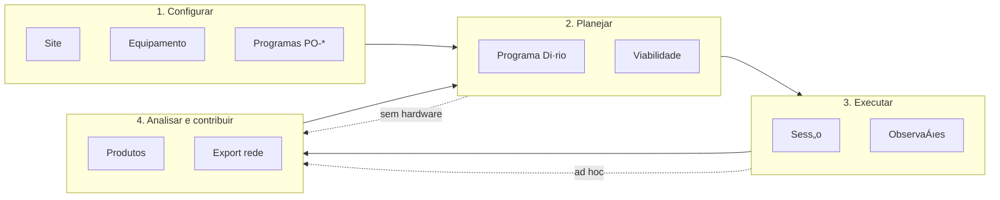
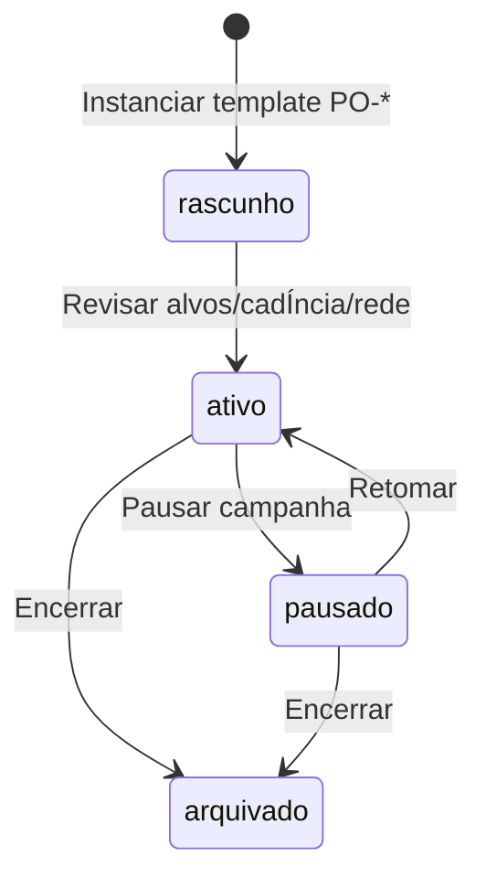
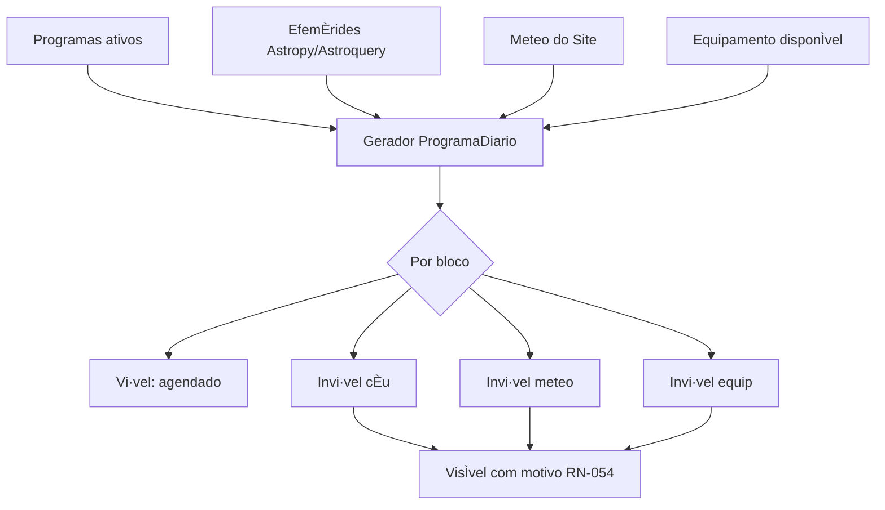
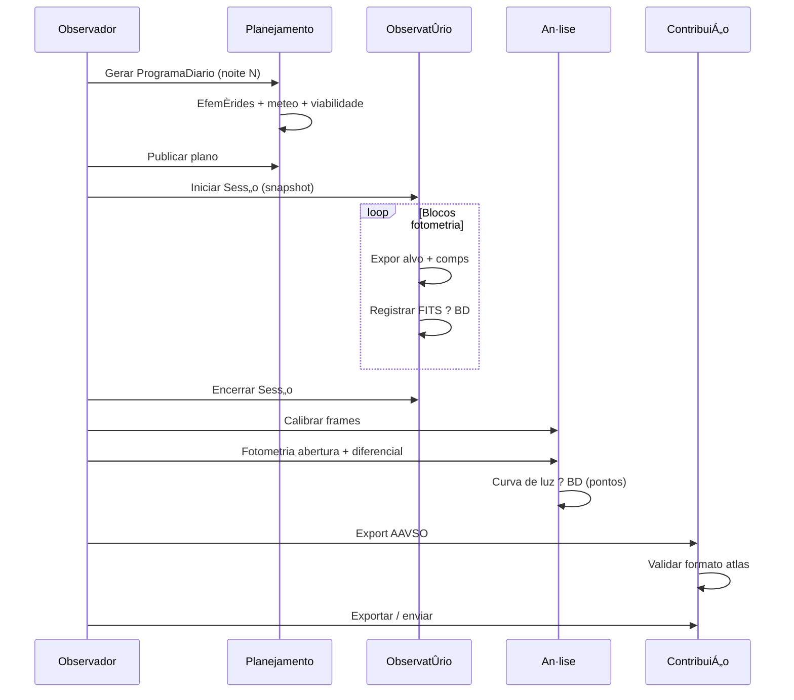

# Workflows e jornada do usu·rio ó AstroCitizen

**Vers„o:** 1.0  
**Data:** 2026-07-21  
**Status:** especificaÁ„o de produto  
**Fontes:** [ESCOPO_GERAL_E_REGRAS_DE_NEGOCIO.md](ESCOPO_GERAL_E_REGRAS_DE_NEGOCIO.md) (RN-*), [ARQUITETURA.md](ARQUITETURA.md), [PRODUCT_BACKLOG.md](PRODUCT_BACKLOG.md) (AC-*), [PROGRAMAS_OBSERVACIONAIS.md](PROGRAMAS_OBSERVACIONAIS.md) (PO-*)

---

## 1. PropÛsito deste documento

Formaliza a **jornada do usu·rio** na plataforma: modos de uso, passos, estados, alternativas e mapeamento para casos de uso e backlog.

O fluxo de **domÌnio** (entidades, RN-*) j· est· em `ESCOPO_GERAL_E_REGRAS_DE_NEGOCIO.md` ß5. Este documento traduz isso em **experiÍncia de produto** (CLI/GUI, decisıes do observador, telas-alvo).

Contratos de serviÁo detalhados: ver `API_ALVO.md` (pendente).

---

## 2. Personas e perfis de uso

Na v1, **Observador** e **Gestor de programa** s„o o mesmo usu·rio (RN implÌcito em ß3 do escopo).

| Persona | Objetivo tÌpico | Modos mais usados |
|---------|-----------------|-------------------|
| **Observador iniciante** | Configurar site, ativar primeiro PO-*, planejar a noite | Configurar ? Planejar |
| **Observador de campo** | Executar sess„o com hardware, registrar FITS | Executar ? Registrar |
| **Analista offline** | Importar dados, calibrar, produzir curva/espectro, exportar | Analisar ? Contribuir |
| **Gestor de campanhas** | V·rios PO-* ativos, prioridades, contribuiÁıes pendentes | Configurar ? Planejar ? Contribuir |

Cada persona pode usar **apenas um subconjunto** da jornada (RN-055: planejamento sem hardware; an·lise dias depois ó RN-073).

---

## 3. Jornada macro (quatro modos)

| Modo | Caso de uso (app) | …picos backlog | Regras-chave |
|------|-------------------|----------------|--------------|
| **Configurar** | `GerirSite`, `GerirEquipamento`, `GerirProgramas` | E2, E7 | RN-001Ö004, RN-030Ö035, RN-040Ö047 |
| **Planejar** | `PlanejarDia` | E3, E7 | RN-010Ö014, RN-020Ö024, RN-050Ö056 |
| **Executar** | `ExecutarSessao`, `RegistrarObservacao` | E4, E5, E7 | RN-060Ö064, RN-090Ö092 |
| **Analisar e contribuir** | `Analisar`, `ExportarRede` | E6, E9ñE14, E7 | RN-070Ö073, RN-080Ö083, RN-110Ö116 |

---

## 4. Mapa de navegaÁ„o (GUI-alvo)

Shell PySide6 com mÛdulos alinhados aos bounded contexts (AC-071):

| ¡rea | Conte˙do principal | Workflow ß |
|------|-------------------|------------|
| **InÌcio** | Site ativo, meteo resumida, programa di·rio de hoje, alertas | ß5, ß6 |
| **Sites** | CRUD SiteProfile, limiares meteo/altitude | ß5.1 |
| **Equipamento** | Invent·rio, configuraÁıes instrumentais, backends | ß5.2 |
| **Programas** | Cat·logo PO-*, campanhas ativas, painel multi-programa | ß5.3 |
| **Planejamento** | Programa di·rio, timeline, blocos, viabilidade | ß6 |
| **ObservatÛrio** | Sess„o ao vivo, c‚mera/montagem/focuser, fila de blocos | ß7 |
| **Arquivo** | ObservaÁıes, produtos, busca por programa/alvo/data | ß8 |
| **An·lise** | ReduÁ„o, curvas, espectros, astrometria (por tÈcnica) | ß8 |
| **ContribuiÁ„o** | Rascunhos de export, validaÁ„o, envio | ß9 |
| **DiagnÛstico** | Simuladores, teste de hardware (RN-090 exceÁ„o) | ß7.4 |

CLI espelha os mesmos fluxos (AC-070): `astrocitizen site Ö`, `program Ö`, `plan Ö`, `session Ö`, `analyze Ö`, `export Ö`.

---

## 5. Modo 1 ó Configurar

### 5.1 Cadastrar e selecionar Site

**Objetivo:** todo planejamento e registro referem-se a um local explÌcito (RN-001).

| Passo | AÁ„o do usu·rio | Sistema | SaÌda |
|-------|-----------------|---------|-------|
| 1 | Criar Site (nome, lat, lon, alt, fuso) | Valida coordenadas | Site no BD |
| 2 | Opcional: limiares (alt. mÌn., meteo, crep˙sculo) | Defaults da plataforma + override | SiteProfile completo |
| 3 | Definir Site **ativo** | Recalcula caches de efemÈrides/meteo se houver plano | Contexto global da sess„o UI/CLI |

**Alternativas:** editar Site existente; trocar Site ativo ? ProgramaDiario em ediÁ„o deve ser recalculado (RN-002).

**Backlog:** AC-020, AC-072.

---

### 5.2 Invent·rio de equipamento

**Objetivo:** blocos do programa di·rio declaram configuraÁ„o instrumental v·lida (RN-030Ö035).

| Passo | AÁ„o | Sistema | SaÌda |
|-------|------|---------|-------|
| 1 | Registrar item (montagem, c‚mera, focuser, filtro, espectrÛgrafoÖ) | Tipo + metadados + backend | Equipamento no BD |
| 2 | Marcar disponibilidade (manutenÁ„o) | RN-035 | Flag no invent·rio |
| 3 | Criar **ConfiguraÁ„oInstrumental** (preset) | Valida compatibilidade tÈcnica | Preset reutiliz·vel |
| 4 | Escolher backend de c‚mera: `sim` \| `alpaca` \| `udrv` | AC-046 | PreferÍncia persistida |

**Alternativas:** diagnÛstico de conex„o Alpaca/udrv (sem Sessao ativa ó RN-090).

**Backlog:** AC-021, AC-040Ö047, AC-072.

---

### 5.3 Ativar programas observacionais (PO-*)

**Objetivo:** campanhas de longo prazo alimentam candidatos do programa di·rio (RN-040Ö047).

| Passo | AÁ„o | Sistema | SaÌda |
|-------|------|---------|-------|
| 1 | Escolher template **PO-*** no cat·logo | Carrega metadados (tÈcnica, rede, produto mÌnimo) | ProgramaObservacional `rascunho` |
| 2 | Configurar alvos, cadÍncia, prioridade, config. instrumental padr„o | Valida contra CS-* / PO-* | Programa edit·vel |
| 3 | Ativar | SÛ `ativo` entra no gerador di·rio (RN-041) | Programa `ativo` |
| 4 | (Opcional) Ativar segundo programa | Conflitos resolvidos por prioridade depois (RN-042) | Multi-programa |

**Painel de gest„o** (requisito ß8 escopo): lista programas, prÛxima janela, obs. recentes, export pendente, alertas (AC-074).

**Backlog:** AC-022, AC-023, AC-081Ö088.

---

## 6. Modo 2 ó Planejar

### 6.1 Gerar Programa Di·rio

**Objetivo:** um plano por Site e por noite (RN-050), combinando ciÍncia, cÈu, meteo e equipamento.

| Passo | AÁ„o | Sistema | SaÌda |
|-------|------|---------|-------|
| 1 | Selecionar data (noite civil do Site, RN-004) | ó | Data alvo |
| 2 | **Gerar / atualizar** plano | Programas ativos + EphemerisPort + MeteoPort + invent·rio | ProgramaDiario `rascunho` |
| 3 | Revisar lista de **BlocosObservacionais** | Cada bloco: alvo, janela UT, Alt/Az, airmass, programa origem | Lista ordenada |
| 4 | Inspecionar status por bloco | RN-053 | `candidato`, `agendado`, `inviavel_*`, Ö |
| 5 | Editar manualmente (reordenar, incluir alvo, remover) | RN-052; motivo preservado para invi·veis | Plano ajustado |
| 6 | **Publicar** plano | Estado `publicado` | Plano pronto para sess„o ou referÍncia |

**InformaÁ„o mÌnima por bloco** (escopo ß8): alvo, janela UT, altitude, airmass, status cÈu/meteo/equip, config. instrumental, programa, prioridade, notas.

**Alternativas:**

- **Meteo indisponÌvel:** blocos marcados; usu·rio pode sobrescrever com `meteo_manual=true` na sess„o (RN-023).
- **EfemÈride remota falhou:** cache local ou `efemÈride indisponÌvel` (RN-014).
- **Modo planejamento puro:** sem hardware conectado (RN-055).

**Backlog:** AC-030Ö037, AC-073.

---

### 6.2 Checklist prÈ-noite (operacional)

Checklist sugerido na UI antes de `em_execucao` (n„o bloqueante, configur·vel):

1. Site e data corretos  
2. Previs„o meteo revisada  
3. ConfiguraÁ„o instrumental dos blocos agendados conferida  
4. Masters de calibraÁ„o recentes (PO-J03) ó alerta se ausentes  
5. EspaÁo em disco / caminho de artefatos  
6. Backends de hardware testados (ou simulador selecionado)

---

## 7. Modo 3 ó Executar

### 7.1 Iniciar Sess„o

**Objetivo:** executar blocos do ProgramaDiario com rastreabilidade (RN-056).

| Passo | AÁ„o | Sistema | SaÌda |
|-------|------|---------|-------|
| 1 | Abrir **ObservatÛrio ? Nova sess„o** | Lista planos `publicado` para Site/data | ó |
| 2 | Confirmar ProgramaDiario | **Snapshot** imut·vel do plano (RN-056) | Sessao + plano congelado |
| 3 | Snapshot meteo inÌcio | RN-022 | CondiÁ„oMeteo ligada ‡ Sessao |
| 4 | Conectar backends (montagem, c‚mera, focuser) | Factory AC-046 | Status conectado / simulado |
| 5 | Estado di·rio ? `em_execucao` | ó | ProgramaDiario atualizado |

**Regra:** comandos slew/exposiÁ„o sÛ com Sessao ativa (RN-090), exceto diagnÛstico.

**Backlog:** AC-050, AC-073.

---

### 7.2 Executar bloco (loop da noite)

| Passo | AÁ„o | Sistema | SaÌda |
|-------|------|---------|-------|
| 1 | Selecionar prÛximo bloco `agendado` | Opcional: slew via MountPort | Bloco `em_execucao` |
| 2 | Focar / filtro / sequÍncia de exposiÁıes | CameraPort, FocuserPort | Frames brutos |
| 3 | **Registrar ObservaÁ„o** | FITS ? ArtifactStore; metadados ? BD (RN-060Ö062) | Observacao `bruta` |
| 4 | Marcar bloco `concluido` ou `pulado` (motivo) | ó | Status bloco |
| 5 | Repetir atÈ fim da fila ou encerrar | ó | ó |

**Metadados obrigatÛrios:** Site, UTC, alvo, config. instrumental, bloco/programa, backend c‚mera, meteo, flags (`simulada`, `meteo_manual`).

**Backlog:** AC-051, AC-052, AC-053.

---

### 7.3 Encerrar Sess„o

| Passo | AÁ„o | Sistema |
|-------|------|---------|
| 1 | Snapshot meteo fim | RN-022 |
| 2 | Resumo: blocos concluÌdos / pulados / falhou | Log audit·vel |
| 3 | ProgramaDiario ? `encerrado` | HistÛrico consult·vel (RN-073) |

---

### 7.4 Fluxos alternativos na execuÁ„o

| SituaÁ„o | Comportamento |
|----------|---------------|
| **Falha de instrumento** | Bloco `falhou`; default pausar e alertar (RN-092) |
| **Troca de equipamento mid-session** | Novo trecho de log; n„o sobrescrever metadados anteriores (RN-034) |
| **ObservaÁ„o ad hoc** | Registrar sem bloco; associar a programa depois (RN-063, AC-054) |
| **Simulador / CI** | Observacao com `simulada=true` (RN-091, RN-115) |
| **Importar FITS externos** | Entra como Observacao via `RegistrarObservacao`; mesmo fluxo de an·lise |

---

## 8. Modo 4 ó Analisar

### 8.1 ReduÁ„o e produtos

**Objetivo:** gerar ProdutoAnalise versionado, ligado ‡s Observacoes (RN-061, RN-071).

| Passo | AÁ„o | Sistema | SaÌda |
|-------|------|---------|-------|
| 1 | Selecionar Observacao(s) no Arquivo | Filtro por programa, data, PO-* | ó |
| 2 | Calibrar (bias/dark/flat) se necess·rio | Masters versionados (PO-J01/J03) | Observacao `calibrada` |
| 3 | Executar an·lise conforme **tÈcnica do programa** | Plugin PO-* / reduÁ„o | ProdutoAnalise v1 |
| 4 | Reprocessar (opcional) | Nova vers„o; marcar uma como **public·vel** (RN-072) | Produto `publicavel` |

An·lise depende do tipo de programa (RN-070): fotometria, espectro, astrometria, timing, imaging, etc.

**Backlog:** AC-060Ö063, E9ñE13 conforme tÈcnica.

---

### 8.2 Estados da observaÁ„o (vis„o usu·rio)

---

## 9. Modo 4 (cont.) ó Contribuir ‡s redes

**Objetivo:** ContribuicaoRede atende produto mÌnimo do PO-* e formato do atlas (RN-080Ö083).

| Passo | AÁ„o | Sistema | SaÌda |
|-------|------|---------|-------|
| 1 | Abrir **ContribuiÁ„o** filtrada por programa/rede | Lista produtos elegÌveis | ó |
| 2 | Gerar pacote de export | Valida produto mÌnimo (RN-043, RN-080) | ContribuicaoRede `rascunho` |
| 3 | Revisar campos (atlas ATLAS_REPORTE) | PrÈ-preenchimento do BD | Rascunho edit·vel |
| 4 | Validar | Checks de formato | `validado` |
| 5 | Exportar arquivo / enviar | Credenciais locais (RN-082) | `exportado` / `enviado` |

Estados: `rascunho` ? `validado` ? `exportado` ? `enviado` | `rejeitado` (RN-081).

**Backlog:** E14, AC-093, AC-104, AC-112, etc.

---

## 10. Fluxo ponta a ponta de referÍncia ó PO-A01 (AAVSO)

Template: **Estrelas vari·veis (geral)** ó fotometria diferencial, rede AAVSO (P1).

### PrÈ-requisitos

- Site ativo configurado  
- C‚mera + (opcional) montagem no invent·rio  
- Programa instanciado de PO-A01, estado `ativo`, alvo vari·vel + comparaÁ„o + check definidos  
- Masters bias/dark/flat recentes (PO-J03 recomendado)

### SequÍncia

### Passos numerados (critÈrio de aceite de produto)

| # | Fase | Entreg·vel |
|---|------|------------|
| 1 | Configurar | Site + PO-A01 ativo |
| 2 | Planejar | ProgramaDiario com bloco(s) vari·vel vi·vel |
| 3 | Executar | ?1 Observacao FITS com metadados completos |
| 4 | Analisar | ProdutoAnalise curva de luz (pontos no BD) |
| 5 | Contribuir | ContribuicaoRede AAVSO `validado` ou `exportado` |

**Itens backlog associados:** AC-081, AC-091, AC-092, AC-093.

---

## 11. VariaÁıes por famÌlia PO-* (resumo)

| FamÌlia | DiferenÁa na jornada (vs. PO-A01) |
|---------|-----------------------------------|
| **PO-B** (espectro) | Blocos com config. espectrÛgrafo; an·lise = extraÁ„o 1D + ?; export ARAS/BeSS |
| **PO-C** (NEO/SN) | EfemÈrides Horizons/MPC; astrometria/blink; export MPC/TNS |
| **PO-D** (IOTA) | Janelas estreitas + margem (RN-013); timing de alta precis„o; export IOTA |
| **PO-E** (solar/planet·rio) | Regras de cÈu diurno (exceÁ„o RN-012); filtros solares obrigatÛrios |
| **PO-J** (calibraÁ„o/meteo) | Blocos de flat/dark/bias; produto = masters + perfil meteo site |

Cada template PO-* reutiliza os **mesmos quatro modos**; plugins alteram validaÁ„o, an·lise e export (ARQUITETURA ß5).

---

## 12. Matriz modo ◊ artefato de domÌnio

| Artefato | Configurar | Planejar | Executar | Analisar | Contribuir |
|----------|:----------:|:--------:|:--------:|:--------:|:----------:|
| Site | C/R/U | R | R | R | R |
| Equipamento | C/R/U | R | R | ó | ó |
| ProgramaObservacional | C/R/U | R | R | R | R |
| ProgramaDiario | ó | C/R/U | R | R | ó |
| Sessao | ó | ó | C/U | R | ó |
| Observacao | ó | ó | C | R/U | R |
| ProdutoAnalise | ó | ó | ó | C/R/U | R |
| ContribuicaoRede | ó | ó | ó | R | C/R/U |

Legenda: C criar, R ler, U atualizar.

---

## 13. Mapeamento casos de uso ? backlog

| Caso de uso | Itens AC-* principais |
|-------------|------------------------|
| `GerirSite` | AC-020, AC-072 |
| `GerirEquipamento` | AC-021, AC-040Ö047, AC-072 |
| `GerirProgramas` | AC-022, AC-023, AC-074, AC-081Ö088 |
| `PlanejarDia` | AC-030Ö037, AC-073 |
| `ExecutarSessao` | AC-050, AC-053, AC-073 |
| `RegistrarObservacao` | AC-051, AC-052, AC-054 |
| `Analisar` | AC-060Ö063, AC-090Ö105, AC-110Ö |
| `ExportarRede` | E14, atlas, AC-093+ |

---

## 14. CritÈrios de aceite UX (Fase 1)

A jornada est· implementada no mÌnimo quando um usu·rio consegue, **via CLI ou GUI**:

1. **Configurar** um Site e ativar PO-A01.  
2. **Planejar** um ProgramaDiario com status de viabilidade visÌvel.  
3. **Executar** uma Sessao (simulador aceito) e registrar Observacao no BD.  
4. **Analisar** atÈ um ProdutoAnalise mÌnimo (mesmo que reduÁ„o simplificada na P1).  
5. **Preparar** um export AAVSO em rascunho validado contra o atlas.

Isso espelha os critÈrios de negÛcio do escopo ß10.

---

## 15. Fora de escopo deste documento

- Layout visual final (wireframes) ó derivado destes fluxos na implementaÁ„o de E7.  
- Contratos de API (`API_ALVO.md`).  
- Schema SQL detalhado (`PERSISTENCIA_E_BANCOS.md`).  
- Fluxo de r·dio amador ó produto irm„o, eixo paralelo (REVISAO ß).

---

## 16. HistÛrico

| Vers„o | Data | Notas |
|--------|------|-------|
| 1.0 | 2026-07-21 | Documento inicial; quatro modos; PO-A01 referÍncia; mapa GUI/CLI |

| 1.1 | 2026-07-21 | §17 — mapeamento SaaS + Desktop (D-008) |

---

## 17. Mapeamento SaaS + Desktop (D-008)

A jornada dos quatro modos distribui-se entre os dois módulos de produto. Detalhe: [ARQUITETURA_SAAS_DESKTOP.md](ARQUITETURA_SAAS_DESKTOP.md).

| Modo | SaaS (web) | Desktop (observatório) |
|------|------------|------------------------|
| **1. Configurar** | Sites, programas PO-*, invent√°rio (cadastro) | Estado de conex√£o do equipamento; espelho local |
| **2. Planejar** | Gerar, editar e publicar ProgramaDiario | Pull do plano publicado; checklist pré-noite |
| **3. Executar** | Monitoramento (futuro) | Sessão, hardware, aquisição, registro FITS |
| **4. Analisar e contribuir** | Redução, produtos, export AAVSO/MPC/… | Opcional: preview local; sync de observações |

### Fluxo típico ponta a ponta

1. Usu√°rio configura site e PO-A01 no **SaaS**.
2. Planeja e publica ProgramaDiario no **SaaS**.
3. **Desktop** sincroniza plano (pull).
4. Observador executa sess√£o no **Desktop** (offline permitido).
5. **Desktop** envia observações e FITS (push + upload).
6. Usu√°rio analisa e exporta no **SaaS**.

### UI por módulo

| Área WORKFLOWS §4 | SaaS | Desktop |
|-------------------|:----:|:-------:|
| Início | Dashboard workspace | Console de sessão + status sync |
| Sites / Equipamento / Programas | Principal | Cache + diagnóstico hardware |
| Planejamento | Principal | Leitura do plano sincronizado |
| Observatório | — | Principal |
| Arquivo / Análise / Contribuição | Principal | Consulta cache + fila pendente |

Modo **SaaS-only** (sem Desktop): importar FITS via web e seguir análise/contribuição (ver MODELO_DE_SINCRONIZACAO §12).
