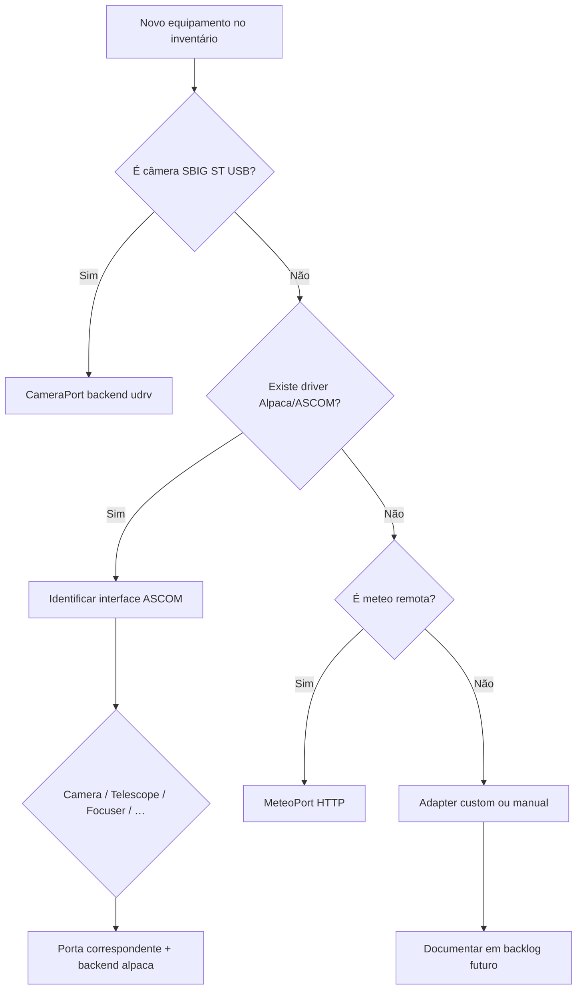

# Mapeamento equipamento ? ASCOM ? driver ? porta AstroCitizen

**Versão:** 1.0  
**Data:** 2026-07-21  
**Status:** especificação de integração hardware (Desktop)  
**Relacionados:** [README.md](README.md) · [INDICE_ASCOM.md](INDICE_ASCOM.md) · [STACK_TECNOLOGICA.md](../STACK_TECNOLOGICA.md) · [ARQUITETURA_SAAS_DESKTOP.md](../ARQUITETURA_SAAS_DESKTOP.md)

---

## 1. Resumo executivo

| Pergunta | Resposta |
|----------|----------|
| O ASCOM cobre **qualquer** equipamento astronômico? | **Não** — só categorias com interface padronizada e driver disponível |
| Temos drivers para tudo? | **Não** — drivers vêm do fabricante/comunidade; nós implementamos **adapters** |
| Câmeras SBIG ST USB? | **Fora ASCOM** ? backend `udrv` (sbig-suite) |
| Montagens típicas? | **Sim**, via interface **Telescope** + Alpaca |
| Automação de observatório? | **Parcial** — cúpula, switches, sensores; não PLCs genéricos |
| Caminho preferido multiplataforma? | **ASCOM Alpaca** + **Alpyca** (D-005, D-006) |

> **Nota ASCOM 2026:** novos drivers e aplicações devem priorizar [Alpaca](https://ascom-standards.org/index.htm) (HTTP/JSON, Linux/Windows/macOS). COM clássico permanece como legado Windows.

---

## 2. Modelo de três camadas

```text
???????????????????????????????????????????????????????????????
?  Equipamento físico (marca/modelo)                          ?
?  ST-8XME · CGEM · EQMOD · Lhires · ZWO ASI…                 ?
???????????????????????????????????????????????????????????????
                            ?
                            ?
???????????????????????????????????????????????????????????????
?  Driver / servidor (instalado pelo usuário)                 ?
?  udrv SBIG · driver ASCOM/Alpaca do fabricante · ASCOM Remote?
???????????????????????????????????????????????????????????????
                            ?
                            ?
???????????????????????????????????????????????????????????????
?  AstroCitizen Desktop — portas + backends                   ?
?  CameraPort · MountPort · FocuserPort · FilterWheelPort …   ?
???????????????????????????????????????????????????????????????
```

**Regra (RN-032):** o usuário escolhe o backend na sessão; a escolha persiste na `Observacao`.

---

## 3. Tabela mestra por categoria

Legenda:

- **Cobertura ASCOM:** `Total` · `Parcial` · `Não` · `Via adapter`
- **Prioridade AC:** item do [PRODUCT_BACKLOG.md](../PRODUCT_BACKLOG.md)
- **Drivers:** exemplos conhecidos — **não exaustivo**; verificar no site do fabricante

| Equipamento | Interface ASCOM | Cobertura | Driver / stack típico | Porta AstroCitizen | Backend Desktop | Pri |
|-------------|-----------------|-----------|----------------------|-------------------|-----------------|-----|
| **Câmera CCD/CMOS (ASCOM)** | `ICameraV3/V4` | Total* | ZWO ASI, QHY, Atik, Moravian, Apogee, FLI… drivers Alpaca ou COM+Remote | `CameraPort` | `alpaca` | P1 |
| **Câmera SBIG ST USB** | — | Não | **Universal Driver (udrv)** — sbig-suite | `CameraPort` | `udrv` | P1 |
| **Câmera SBIG (alguns modelos)** | `ICamera` | Parcial | Driver ASCOM SBIG (legado, Windows) | `CameraPort` | `alpaca`* | P2 |
| **Montagem equatorial / alt-az** | `ITelescopeV3/V4` | Total* | EQMOD, Celestron, SkyWatcher, Meade/LX200, PlaneWave, iOptron, ASCOM Universal Mount | `MountPort` | `alpaca` | P1 |
| **Focuser motorizado** | `IFocuserV3/V4` | Total* | Moonlite, Optec, Pegasus, ZWO EAF, Feathertouch… | `FocuserPort` | `alpaca` | P1 |
| **Roda de filtros** | `IFilterWheelV2/V3` | Total* | SBIG CFW, ZWO EFW, Moravian, Optec… | `FilterWheelPort` | `alpaca` | P2 |
| **Cond. observacionais locais** | `IObservingConditions(V2)` | Parcial | Sensores via driver ASCOM; cloud/wind/temp se suportado | `ObservingConditionsPort` | `alpaca` | P2 |
| **Cúpula** | `IDomeV2/V3` | Total* | Dome drivers (Observatory, Shutter, homebrew Alpaca) | `DomePort` (futuro) | `alpaca` | P3 |
| **Rotador de campo** | `IRotatorV3/V4` | Total* | Pegasus, PlaneWave… | `RotatorPort` (futuro) | `alpaca` | P3 |
| **Flat box / tampa calibração** | `ICoverCalibratorV1/V2` | Total* | Alnitak, Pegasus… | `CoverCalibratorPort` (futuro) | `alpaca` | P3 |
| **Relés / power / automação simples** | `ISwitchV2/V3` | Parcial | Switch drivers ASCOM | `SwitchPort` (futuro) | `alpaca` | P3 |
| **Monitor de segurança** | `ISafetyMonitor` | Parcial | Rain/cloud sensors ASCOM | `SafetyMonitorPort` (futuro) | `alpaca` | P3 |
| **Simulador (dev/CI)** | Todas | Total | [Alpaca Omni Simulators](https://ascom-standards.org/) | Todas | `sim` | P1 |
| **Espectrógrafo slit (Lhires, Alpy)** | — | Não | Software ISIS/Shelyak; câmera pode ser ASCOM ou udrv | — | ver §5 | P2 |
| **Espectrógrafo SBIG DSS-7** | — | Não | Pipeline SBIG / legado | `CameraPort`? | `udrv` + futuro | P3 |
| **Guiador (PHD2)** | — | Não | API PHD2 / DDE (protocolo próprio) | `GuiderPort` (futuro) | adapter | P3 |
| **DSLR Canon/Nikon** | Parcial | Parcial | ASCOM DSLR drivers (Windows, limitado) | `CameraPort` | `alpaca` / manual | P3 |
| **Meteo remota (API)** | — | Não | Open-Meteo, Weather.gov… | `MeteoPort` (SaaS/Desktop) | HTTP API | P1 |
| **Rádio astronomia** | — | Não | SDR, backends dedicados | eixo paralelo | — | P3 |

\* *Total* = interface ASCOM completa existe; **requer driver Alpaca/COM instalado para o modelo concreto*.

---

## 4. Detalhamento por família

### 4.1 Câmeras

| Modelo / família | ASCOM? | Driver / notas | Backend AstroCitizen |
|------------------|--------|----------------|----------------------|
| **SBIG ST-7/ST-8/ST-10/STF… USB** | Não (udrv) | Universal Driver SBIG | **`udrv`** ? caminho principal Gramadão |
| ZWO ASI | Sim | ZWO ASCOM/Alpaca driver | `alpaca` |
| QHY | Sim | QHY ASCOM/Alpaca | `alpaca` |
| Atik, Moravian, FLI, Apogee | Sim | Driver do fabricante | `alpaca` |
| DSI Pro / STF (legado) | Parcial | Drivers Windows antigos | `alpaca` ou `udrv` |
| Câmera guia separada | Sim | Mesmo que câmera principal | `alpaca` (segunda instância) |

**Doc ASCOM:** [mirror/newdocs/camera.html](mirror/newdocs/camera.html)  
**Backlog:** AC-040, AC-041, AC-042, AC-046

### 4.2 Montagens

| Modelo / família | Driver típico | Notas Linux |
|------------------|---------------|-------------|
| **Celestron** (CGEM, AVX, Evolution…) | Celestron Unified Driver ? Alpaca | Remote ou Alpaca nativo |
| **SkyWatcher / Orion** | EQMOD, SkyWatcher ASCOM | EQMOD com Alpaca wrapper |
| **Meade / LX200** | Meade ASCOM, LX200 Classic | ASCOM Remote em Windows |
| **iOptron, PlaneWave, 10micron** | Driver ASCOM/Alpaca do fabricante | Verificar Alpaca |
| **Montagem genérica** | ASCOM Universal Mount | Teste / simulador |

**Doc ASCOM:** [mirror/newdocs/telescope.html](mirror/newdocs/telescope.html)  
**Backlog:** AC-043, AC-046

### 4.3 Focuser e roda de filtros

| Equipamento | Interface | Notas |
|-------------|-----------|-------|
| Focuser USB (Moonlite, Optec, ZWO EAF…) | `IFocuserV4` | AC-044 |
| SBIG CFW integrada ou externa | `IFilterWheelV3` | Pode coexistir com udrv na mesma sessão |
| Focuser manual | — | Sem porta; operação manual fora do software |

### 4.4 Automação de observatório

| Função | Interface ASCOM | Limitação |
|--------|-----------------|-----------|
| Abrir/fechar cúpula | `IDomeV3` | Driver específico da cúpula |
| Sincronizar cúpula ? telescópio | `IDome` + `ITelescope` | Lógica no Desktop |
| Relés (luz, power, ventilador) | `ISwitch` | ON/OFF; não lógica PLC complexa |
| Sensor chuva / cloud | `ISafetyMonitor` | Depende do hardware |
| Flat automático | `ICoverCalibrator` | Tampa motorizada |
| **PLC / Arduino custom** | Não | Adapter futuro (`SwitchPort` ou serial) |

**Backlog:** E17 Observatório avançado

---

## 5. Fora do ASCOM — estratégia AstroCitizen

Equipamento **sem** interface ASCOM nativa:

| Equipamento | Estratégia | Fase |
|-------------|------------|------|
| **SBIG ST USB** | `UdrvBackend` ? sbig-suite | P1 |
| **Lhires III / Alpy** | Câmera via ASCOM/udrv; controle do espectrógrafo (slit, calib lamp) manual ou adapter Shelyak futuro | P2–P3 |
| **DSS-7 (SBIG)** | Integração sbig-suite / módulo spectral | P3 |
| **PHD2 (guiagem)** | `GuiderPort` ? API PHD2 | P3 |
| **Plate solving** | Integração externa (ASTAP, astrometry.net) | P2 |
| **Meteo API** | `MeteoPort` HTTP (não ASCOM) | P1 |
| **Rádio amador** | Módulo paralelo (CS-*) | P3 |

Estes itens **não invalidam** o ASCOM como caminho principal — complementam onde o padrão não chega.

---

## 6. Configuração de referência — observatório Gramadão (literatura)

Hardware recorrente no acervo (`Astronomia Gramadão SBIG`, `ST-7/`, revisão observacional):

| Peça | Provável stack | Porta | Backend |
|------|----------------|-------|---------|
| Câmera **SBIG ST-8** (ou ST-7) | udrv USB | `CameraPort` | **`udrv`** |
| Montagem (CGEM / Meade / similar) | Driver ASCOM ? Alpaca | `MountPort` | **`alpaca`** |
| Focuser | Driver ASCOM/Alpaca | `FocuserPort` | **`alpaca`** |
| CFW SBIG | ASCOM FilterWheel ou via câmera | `FilterWheelPort` | **`alpaca`** ou udrv |
| Espectrógrafo Lhires/Alpy | Sem ASCOM direto | — | câmera + workflow manual |
| Site | `SiteProfile` Gramadão | SaaS/Desktop | BD |

> Preencher coluna exacta de hardware quando o inventário físico for confirmado (PLATAFORMA §9, passo 4).

---

## 7. Matriz Linux vs Windows

| Cenário | Linux (Desktop) | Windows (Desktop) |
|---------|-----------------|-------------------|
| Câmera SBIG ST | **udrv** nativo | **udrv** nativo |
| Câmera ZWO/QHY/etc. | Alpaca driver nativo ou remoto | Alpaca ou COM+Remote |
| Montagem | Alpaca endpoint (EQMOD Alpaca, Remote) | Alpaca ou COM+ASCOM Platform |
| Dev sem hardware | Omni Simulator | Omni Simulator |
| ASCOM COM clássico | Via **ASCOM Remote** num host Windows | ASCOM Platform 7.x |

**Recomendação:** expor todo hardware Windows-only via **ASCOM Alpaca Remote** na rede local; Desktop Linux fala Alpyca com o endpoint remoto.

---

## 8. Árvore de decisão — escolha de backend



---

## 9. Fluxo de instalação de drivers (operador)

O AstroCitizen **não instala drivers** — documenta e conecta.

1. Identificar marca/modelo do equipamento.  
2. Consultar fabricante ou [ASCOM legacy drivers (GitHub)](https://github.com/ascomghostdrivers/legacydrivers).  
3. Instalar **ASCOM Platform 7.x** (Windows) se driver for COM-only.  
4. Preferir driver **Alpaca nativo** ou configurar **ASCOM Remote**.  
5. No Desktop: cadastrar equipamento no inventário (SaaS) com `backend` e URL/host Alpaca.  
6. Testar conexão (Diagnóstico ? modo simulador se hardware ausente).  
7. Associar `ConfiguraçãoInstrumental` aos programas PO-*.

---

## 10. Mapeamento portas ? classes Alpyca

| Porta AstroCitizen | Classe Alpyca | Interface ASCOM |
|--------------------|---------------|-----------------|
| `CameraPort` | `Camera` | `ICameraV4` |
| `MountPort` | `Telescope` | `ITelescopeV4` |
| `FocuserPort` | `Focuser` | `IFocuserV4` |
| `FilterWheelPort` | `FilterWheel` | `IFilterWheelV3` |
| `ObservingConditionsPort` | `ObservingConditions` | `IObservingConditionsV2` |
| `DomePort` | `Dome` | `IDomeV3` |
| `RotatorPort` | `Rotator` | `IRotatorV4` |
| `CoverCalibratorPort` | `CoverCalibrator` | `ICoverCalibratorV2` |
| `SwitchPort` | `Switch` | `ISwitchV3` |
| `SafetyMonitorPort` | `SafetyMonitor` | `ISafetyMonitorV3` |

Ver PDF: [mirror/alpyca/alpyca.pdf](mirror/alpyca/alpyca.pdf)

---

## 11. Limitações conhecidas (checklist produto)

- [ ] Nem todo equipamento do mercado tem driver ASCOM/Alpaca  
- [ ] Qualidade dos drivers varia (async, estabilidade, ImageArray)  
- [ ] Espectroscopia amadora (slit, calib lamp) raramente ASCOM-complete  
- [ ] Guiagem autónoma (PHD2) fora do escopo Alpaca inicial  
- [ ] Duas câmeras simultâneas = duas instâncias Alpyca (main + guia)  
- [ ] SBIG udrv e Alpaca Camera são **mutuamente excludentes por dispositivo**, não por sessão  
- [ ] SaaS nunca acede hardware — só Desktop (D-008)

---

## 12. Itens de backlog relacionados

| ID | Entrega |
|----|---------|
| AC-040 | `CameraPort` + Simulator |
| AC-041 | Alpaca Camera |
| AC-042 | udrv SBIG (sbig-suite) |
| AC-043 | MountPort + Alpaca Telescope |
| AC-044 | FocuserPort |
| AC-045 | FilterWheel + ObservingConditions |
| AC-046 | Factory `udrv \| alpaca \| sim` |
| AC-047 | Omni Simulator + docs setup |
| E17 | Dome, automação avançada |

---

## 13. Documentos ASCOM locais

| Tema | Caminho |
|------|---------|
| Índice geral | [README.md](README.md) |
| Leitura curada | [INDICE_ASCOM.md](INDICE_ASCOM.md) |
| Interfaces dispositivo | [mirror/newdocs/](mirror/newdocs/) |
| API Alpaca REST | [mirror/AlpacaDeveloper/ASCOMAlpacaAPIReference.html](mirror/AlpacaDeveloper/ASCOMAlpacaAPIReference.html) |

---

## 14. Histórico

| Versão | Data | Notas |
|--------|------|-------|
| 1.0 | 2026-07-21 | Tabela mestra, Gramadão ref., limitações, árvore de decisão |

---

Ver também: [TEST_BACKLOG.md](../TEST_BACKLOG.md) — validação hardware SBIG/Alpaca quando equipamento estiver ligado.
