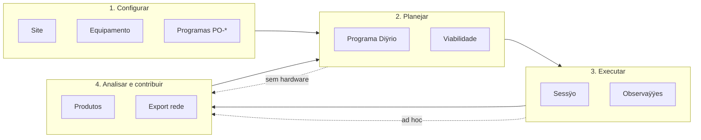

## 3. Jornada macro (quatro modos)

| Modo | Caso de uso (app) | ÿpicos backlog | Regras-chave |
|------|-------------------|----------------|--------------|
| **Configurar** | `GerirSite`, `GerirEquipamento`, `GerirProgramas` | E2, E7 | RN-001ÿ004, RN-030ÿ035, RN-040ÿ047 |
| **Planejar** | `PlanejarDia` | E3, E7 | RN-010ÿ014, RN-020ÿ024, RN-050ÿ056 |
| **Executar** | `ExecutarSessao`, `RegistrarObservacao` | E4, E5, E7 | RN-060ÿ064, RN-090ÿ092 |
| **Analisar e contribuir** | `Analisar`, `ExportarRede` | E6, E9ÿE14, E7 | RN-070ÿ073, RN-080ÿ083, RN-110ÿ116 |

---

## 4. Mapa de navegaÿÿo (GUI-alvo)

Shell PySide6 com mÿdulos alinhados aos bounded contexts (AC-071):

| ÿrea | Conteÿdo principal | Workflow ÿ |
|------|-------------------|------------|
| **Inÿcio** | Site ativo, meteo resumida, programa diÿrio de hoje, alertas | ÿ5, ÿ6 |
| **Sites** | CRUD SiteProfile, limiares meteo/altitude | ÿ5.1 |
| **Equipamento** | Inventÿrio, configuraÿÿes instrumentais, backends | ÿ5.2 |
| **Programas** | Catÿlogo PO-*, campanhas ativas, painel multi-programa | ÿ5.3 |
| **Planejamento** | Programa diÿrio, timeline, blocos, viabilidade | ÿ6 |
| **Observatÿrio** | Sessÿo ao vivo, cÿmera/montagem/focuser, fila de blocos | ÿ7 |
| **Arquivo** | Observaÿÿes, produtos, busca por programa/alvo/data | ÿ8 |
| **Anÿlise** | Reduÿÿo, curvas, espectros, astrometria (por tÿcnica) | ÿ8 |
| **Contribuiÿÿo** | Rascunhos de export, validaÿÿo, envio | ÿ9 |
| **Diagnÿstico** | Simuladores, teste de hardware (RN-090 exceÿÿo) | ÿ7.4 |

CLI espelha os mesmos fluxos (AC-070): `astrocitizen site ÿ`, `program ÿ`, `plan ÿ`, `session ÿ`, `analyze ÿ`, `export ÿ`.

---

## 5. Modo 1 ÿ Configurar
