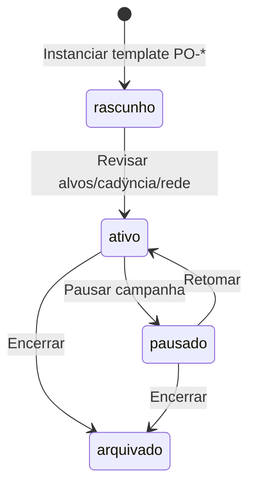

## 5.3 Ativar programas observacionais (PO-*)

**Objetivo:** campanhas de longo prazo alimentam candidatos do programa diÿrio (RN-040ÿ047).

| Passo | Aÿÿo | Sistema | Saÿda |
|-------|------|---------|-------|
| 1 | Escolher template **PO-*** no catÿlogo | Carrega metadados (tÿcnica, rede, produto mÿnimo) | ProgramaObservacional `rascunho` |
| 2 | Configurar alvos, cadÿncia, prioridade, config. instrumental padrÿo | Valida contra CS-* / PO-* | Programa editÿvel |
| 3 | Ativar | Sÿ `ativo` entra no gerador diÿrio (RN-041) | Programa `ativo` |
| 4 | (Opcional) Ativar segundo programa | Conflitos resolvidos por prioridade depois (RN-042) | Multi-programa |

**Painel de gestÿo** (requisito ÿ8 escopo): lista programas, prÿxima janela, obs. recentes, export pendente, alertas (AC-074).

**Backlog:** AC-022, AC-023, AC-081ÿ088.

---

## 6. Modo 2 ÿ Planejar
