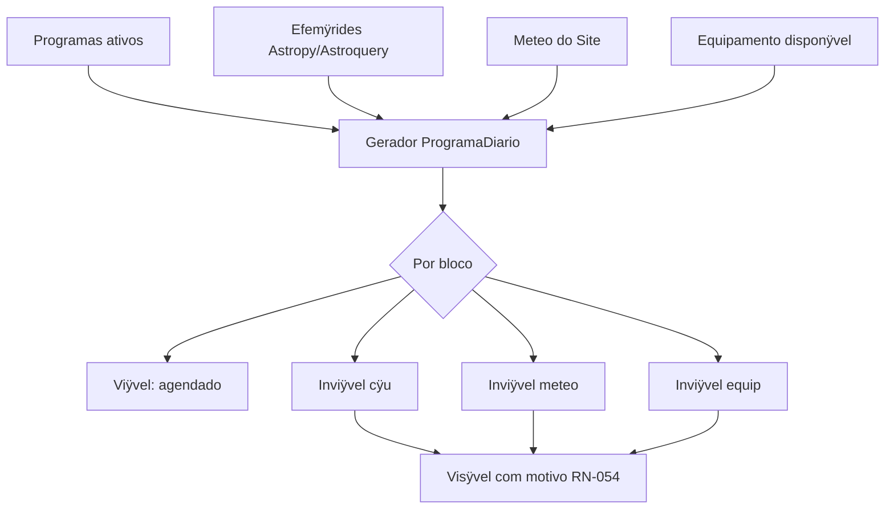

## 6.1 Gerar Programa Diÿrio

**Objetivo:** um plano por Site e por noite (RN-050), combinando ciÿncia, cÿu, meteo e equipamento.

| Passo | Aÿÿo | Sistema | Saÿda |
|-------|------|---------|-------|
| 1 | Selecionar data (noite civil do Site, RN-004) | ÿ | Data alvo |
| 2 | **Gerar / atualizar** plano | Programas ativos + EphemerisPort + MeteoPort + inventÿrio | ProgramaDiario `rascunho` |
| 3 | Revisar lista de **BlocosObservacionais** | Cada bloco: alvo, janela UT, Alt/Az, airmass, programa origem | Lista ordenada |
| 4 | Inspecionar status por bloco | RN-053 | `candidato`, `agendado`, `inviavel_*`, ÿ |
| 5 | Editar manualmente (reordenar, incluir alvo, remover) | RN-052; motivo preservado para inviÿveis | Plano ajustado |
| 6 | **Publicar** plano | Estado `publicado` | Plano pronto para sessÿo ou referÿncia |

**Informaÿÿo mÿnima por bloco** (escopo ÿ8): alvo, janela UT, altitude, airmass, status cÿu/meteo/equip, config. instrumental, programa, prioridade, notas.

**Alternativas:**

- **Meteo indisponÿvel:** blocos marcados; usuÿrio pode sobrescrever com `meteo_manual=true` na sessÿo (RN-023).
- **Efemÿride remota falhou:** cache local ou `efemÿride indisponÿvel` (RN-014).
- **Modo planejamento puro:** sem hardware conectado (RN-055).

**Backlog:** AC-030ÿ037, AC-073.

---

## 6.2 Checklist prÿ-noite (operacional)

Checklist sugerido na UI antes de `em_execucao` (nÿo bloqueante, configurÿvel):

1. Site e data corretos  
2. Previsÿo meteo revisada  
3. Configuraÿÿo instrumental dos blocos agendados conferida  
4. Masters de calibraÿÿo recentes (PO-J03) ÿ alerta se ausentes  
5. Espaÿo em disco / caminho de artefatos  
6. Backends de hardware testados (ou simulador selecionado)

---

## 7. Modo 3 ÿ Executar
