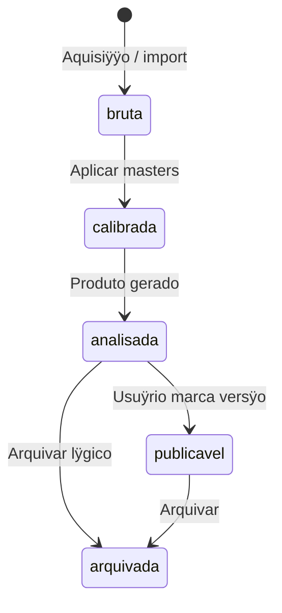

## 7.4 Fluxos alternativos na execuÿÿo

| Situaÿÿo | Comportamento |
|----------|---------------|
| **Falha de instrumento** | Bloco `falhou`; default pausar e alertar (RN-092) |
| **Troca de equipamento mid-session** | Novo trecho de log; nÿo sobrescrever metadados anteriores (RN-034) |
| **Observaÿÿo ad hoc** | Registrar sem bloco; associar a programa depois (RN-063, AC-054) |
| **Simulador / CI** | Observacao com `simulada=true` (RN-091, RN-115) |
| **Importar FITS externos** | Entra como Observacao via `RegistrarObservacao`; mesmo fluxo de anÿlise |

---

## 8. Modo 4 ÿ Analisar

## 8.1 Reduÿÿo e produtos

**Objetivo:** gerar ProdutoAnalise versionado, ligado ÿs Observacoes (RN-061, RN-071).

| Passo | Aÿÿo | Sistema | Saÿda |
|-------|------|---------|-------|
| 1 | Selecionar Observacao(s) no Arquivo | Filtro por programa, data, PO-* | ÿ |
| 2 | Calibrar (bias/dark/flat) se necessÿrio | Masters versionados (PO-J01/J03) | Observacao `calibrada` |
| 3 | Executar anÿlise conforme **tÿcnica do programa** | Plugin PO-* / reduÿÿo | ProdutoAnalise v1 |
| 4 | Reprocessar (opcional) | Nova versÿo; marcar uma como **publicÿvel** (RN-072) | Produto `publicavel` |

Analise depende do tipo de programa (RN-070): fotometria, espectro, astrometria, timing, imaging, etc.

Para espectroscopia (PO-B*): apos extract 1D, `analyze spectrum-report` gera produto `spectrum_report` (AC-106, deterministico). Ver [ANALISE_ESPECTRAL_ASSISTIDA.md](ANALISE_ESPECTRAL_ASSISTIDA.md). Camada LLM/RAG: AC-107 + E19.

**Backlog:** AC-060-063, E9-E13 conforme tecnica; AC-106/107; E19.

---

## 8.2 Estados da observaÿÿo (visÿo usuÿrio)

---
