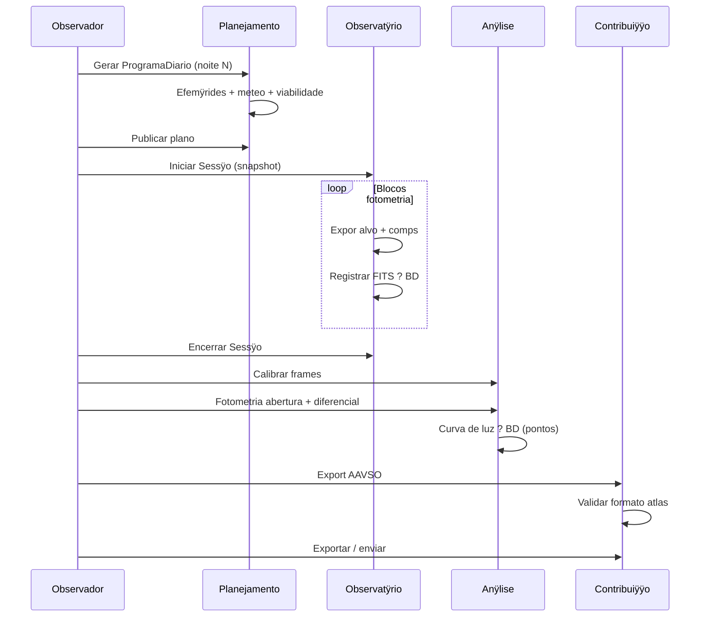

## Sequÿncia

## Passos numerados (critÿrio de aceite de produto)

| # | Fase | Entregÿvel |
|---|------|------------|
| 1 | Configurar | Site + PO-A01 ativo |
| 2 | Planejar | ProgramaDiario com bloco(s) variÿvel viÿvel |
| 3 | Executar | ?1 Observacao FITS com metadados completos |
| 4 | Analisar | ProdutoAnalise curva de luz (pontos no BD) |
| 5 | Contribuir | ContribuicaoRede AAVSO `validado` ou `exportado` |

**Itens backlog associados:** AC-081, AC-091, AC-092, AC-093.

---
